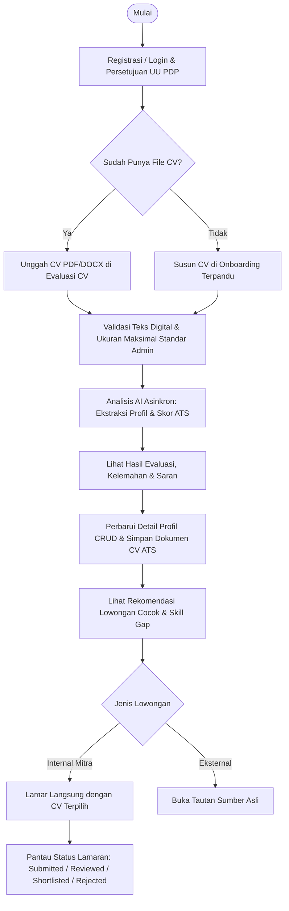
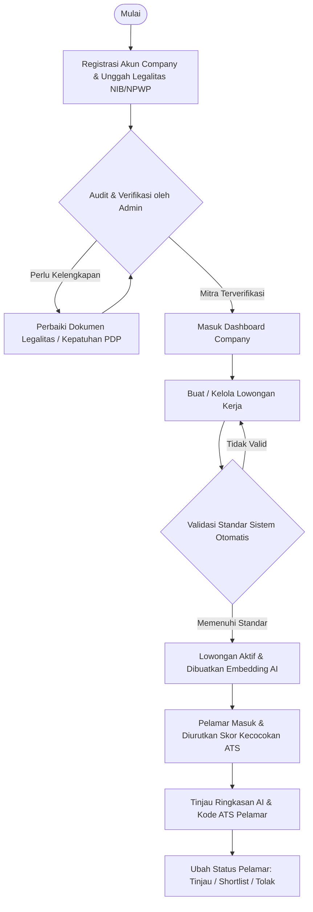
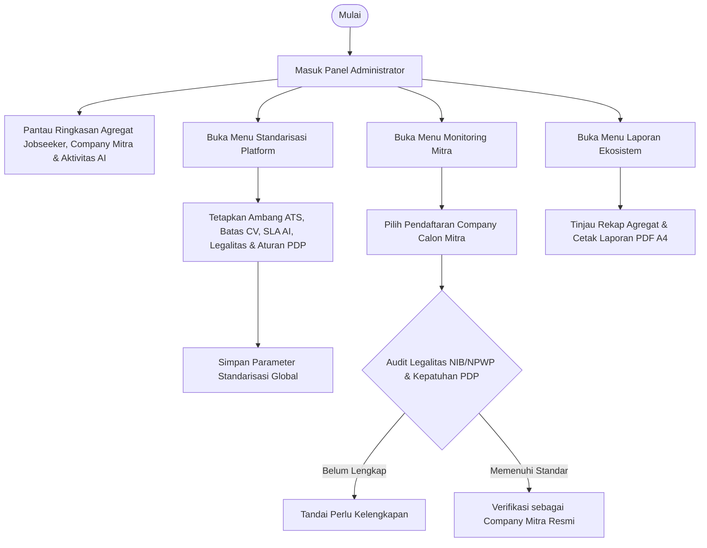

# Dokumentasi Detail Alur & Tugas Tiap Role - Pasbana AI

Dokumen ini menjelaskan secara terperinci alur kerja (*workflow*), tugas utama, batasan wewenang, serta pemetaan halaman antarmuka untuk ketiga *role* pada platform **Pasbana AI**: **Jobseeker**, **Company (Employer)**, dan **Admin**.

---

## 1. Matriks Ringkasan Wewenang Tiap Role

| Aspek | Jobseeker (Pencari Kerja) | Company (Mitra Perusahaan) | Admin (Administrator Platform) |
| --- | --- | --- | --- |
| **Fokus Utama** | Evaluasi CV, peningkatan kesiapan ATS, dan melamar kerja | Publikasi lowongan mandiri dan seleksi pelamar | Standarisasi platform, audit pendaftaran company, dan pemantauan agregat |
| **Akses Data Pengguna** | Hanya data profil & dokumen CV miliknya sendiri | Hanya profil anonim/kode ATS pelamar pada lowongannya | Hanya jumlah agregat jobseeker & company mitra (tanpa intervensi akun individu) |
| **Pengelolaan Lowongan** | Melihat rekomendasi & melamar lowongan aktif | CRUD lowongan perusahaan secara mandiri | Tidak mengelola atau memoderasi isi lowongan company |
| **Audit & Verifikasi** | Validasi format dokumen CV (PDF/DOCX teks digital) otomatis oleh sistem | Mengunggah legalitas usaha (NIB & NPWP) saat mendaftar | Mengaudit legalitas dan memverifikasi pendaftaran company calon mitra |
| **Standarisasi & Kepatuhan** | Menyetujui *consent* UU PDP saat registrasi/unggah CV | Wajib mematuhi standar *blind screening* & deskripsi loker | Menetapkan parameter standar global (ambang ATS, batas CV, aturan PDP) |

---

## 2. Role 1: Jobseeker (Pencari Kerja)

### 2.1 Tujuan & Tugas Utama
- Mengunggah CV digital (PDF/DOCX berbasis teks) atau menyusun CV standar ATS dari nol melalui halaman *Onboarding Terpandu*.
- Meninjau hasil evaluasi AI: skor kesiapan ATS, kekuatan, kelemahan, dan saran perbaikan CV.
- Mengelola detail profil (Identitas, Keahlian, Pengalaman, Pendidikan) dan menyimpan beberapa versi dokumen CV ATS.
- Menjelajahi lowongan yang cocok dengan analisis *skill gap* serta mengajukan lamaran ke *company* mitra atau sumber eksternal.
- Mengelola privasi data pribadi sesuai UU PDP (termasuk hak hapus CV dan akun).

### 2.2 Alur Kerja Detail Jobseeker

### 2.3 Pemetaan Halaman Antarmuka Jobseeker
- **Evaluasi CV** (`/user/dashboard/evaluasi` & `/evaluate`): Mengunggah berkas CV digital untuk dinilai oleh pipeline AI sesuai standar dokumen platform.
- **Onboarding CV** (`/user/dashboard/onboarding` & `/onboarding`): Menyusun CV 1-kolom standar ATS secara bertahap bagi kandidat yang belum memiliki CV.
- **Hasil Evaluasi** (`/user/dashboard/hasil-evaluasi` & `/user/dashboard/riwayat/[id]`): Menampilkan skor 5 dimensi ATS, ringkasan profil hasil ekstraksi AI, kekuatan, kelemahan, dan konsultasi perbaikan.
- **Dokumen CV ATS** (`/user/dashboard/dokumen`): Pratinjau proporsi kertas A4 (210 x 297 mm), tips cetak PDF, kelengkapan 4 bagian CV, dan cetak/unduh PDF.
- **Lowongan Cocok** (`/user/dashboard/lowongan`, `/jobs`, & `/apply/[id]`): Melihat daftar lowongan terurut tingkat kecocokan, alasan kecocokan AI, *skill gap*, dan mengajukan lamaran.
- **Detail Profil (Modal Header)**: Mengubah dan menambah data Identitas, Keahlian, Pengalaman, dan Pendidikan secara CRUD.

---

## 3. Role 2: Company (Employer / Mitra Perusahaan)

### 3.1 Tujuan & Tugas Utama
- Mendaftarkan akun perusahaan dan melengkapi dokumen legalitas (NIB & NPWP) agar diaudit dan diverifikasi oleh Admin.
- Mengelola lowongan pekerjaan secara mandiri (buat, terbitkan, jeda, atau aktifkan kembali lowongan).
- Meninjau daftar pelamar yang sudah diurutkan berdasarkan skor kecocokan ATS dalam mode *blind screening* (tanpa bias usia, gender, agama, atau foto).
- Memperbarui status seleksi pelamar (`Tinjau`, `Shortlist`, `Tolak`) untuk kebutuhan rekrutmen internal perusahaan.
- Memelihara informasi profil perusahaan yang tampil pada portal lowongan.

### 3.2 Batasan Wewenang Company
- Hanya dapat mengakses lowongan milik perusahaannya sendiri dan pelamar yang melamar ke lowongan tersebut.
- Wajib mematuhi standar global platform yang ditetapkan Admin (seperti *blind screening* UU PDP dan format lowongan yang valid).

### 3.3 Alur Kerja Detail Company

### 3.4 Pemetaan Halaman Antarmuka Company
- **Beranda Perusahaan** (`/company/dashboard`): Menampilkan ringkasan lowongan aktif, antrean pelamar terbaru dengan aksi cepat (`Tinjau`, `Shortlist`, `Tolak`), modal popup `Pasang Lowongan`, diagram *funnel* seleksi, dan grafik tren pelamar & lolos ATS.
- **Kelola Lowongan** (`/company/dashboard/lowongan`): Membuat lowongan baru melalui modal popup, menjeda atau mengaktifkan kembali lowongan perusahaan, serta memantau `CompanyFunnelDiagram` dan `CompanyTrendDiagram`.
- **Seleksi Kandidat** (`/company/dashboard/evaluasi`): Daftar pelamar dengan filter status (`Semua`, `Submitted`, `Reviewed`, `Shortlisted`, `Rejected`) dan panel detail kecocokan AI serta tombol status solid.
- **Profil Perusahaan** (`/company/dashboard/dokumen`): Mengelola nama perusahaan, bidang industri, situs web, lokasi kantor utama, deskripsi perusahaan, serta pratinjau kartu mitra dan status kepatuhan UU PDP.

---

## 4. Role 3: Admin (Administrator Platform)

### 4.1 Tujuan & Tugas Utama
- **Melihat Data Agregat Ekosistem**: Memantau total `Jobseeker` terdaftar dan total `Company` yang bekerja sama tanpa mengelola atau menonaktifkan akun individu satu per satu.
- **Audit & Verifikasi Pendaftaran Company**: Mengaudit kelengkapan legalitas usaha (NIB & NPWP) serta kepatuhan standar *blind screening* UU PDP bagi perusahaan yang mendaftar, lalu memberikan keputusan (`Verifikasi`, `Audit`, atau `Lengkapi`).
- **Menetapkan Standarisasi Global Platform**: Mengatur parameter standar yang berlaku di seluruh ekosistem, meliputi:
  - Ambang skor minimum ATS.
  - Batas ukuran berkas CV (MB) dan format dokumen yang diizinkan.
  - Target SLA pemrosesan AI (detik).
  - Kewajiban *blind screening* UU PDP, syarat legalitas *company*, dan kebijakan retensi data CV.
- **Menyusun Laporan Eksekutif Ekosistem**: Memantau pertumbuhan agregat bulanan, tingkat kepatuhan standar mitra, dan mengekspor laporan periodik (PDF A4).

### 4.2 Batasan Wewenang Admin
- **Tidak mengambil andil di dalam ranah internal company**: Admin tidak membuat, mengubah, menyetujui, atau menolak lowongan kerja milik *company*, dan tidak ikut campur dalam proses seleksi pelamar perusahaan.
- **Tidak mengelola akun individu**: Admin hanya melihat metrik agregat pencari kerja dan mitra perusahaan.

### 4.3 Alur Kerja Detail Admin

### 4.4 Pemetaan Halaman Antarmuka Admin
- **Ringkasan Sistem** (`/admin/dashboard`): Menampilkan angka agregat (`Total Jobseeker Terdaftar`, `Company Bekerja Sama`, `Menunggu Audit & Verifikasi`), daftar cepat `Audit & Verifikasi Pendaftaran Company`, diagram `Komposisi Kemitraan Company`, dan diagram `Aktivitas Pipeline AI Mingguan`.
- **Monitoring Mitra** (`/admin/dashboard/lowongan`): Daftar pendaftaran *company* calon mitra dengan panel detail `Audit Legalitas`, `Kepatuhan PDP`, dan tombol `Keputusan Audit & Verifikasi` (`Verifikasi`, `Audit`, `Lengkapi`).
- **Standarisasi Platform** (`/admin/dashboard/evaluasi`): Kartu agregat ekosistem, form `Parameter Standarisasi Global Platform`, dan daftar `Standar Wajib Calon Mitra`.
- **Laporan Ekosistem** (`/admin/dashboard/dokumen`): Filter periode (`Bulan Ini`, `Kuartal`, `2026`), 4 kartu KPI eksekutif, tabel pertumbuhan agregat 6 bulan terakhir, ringkasan kepatuhan standar, dan tombol `Cetak Laporan`.

