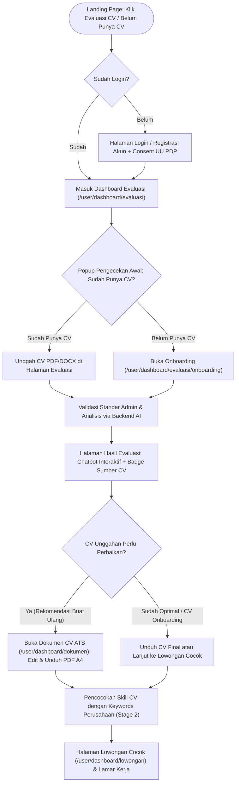
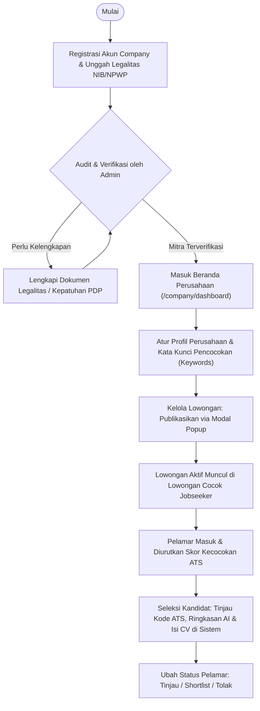
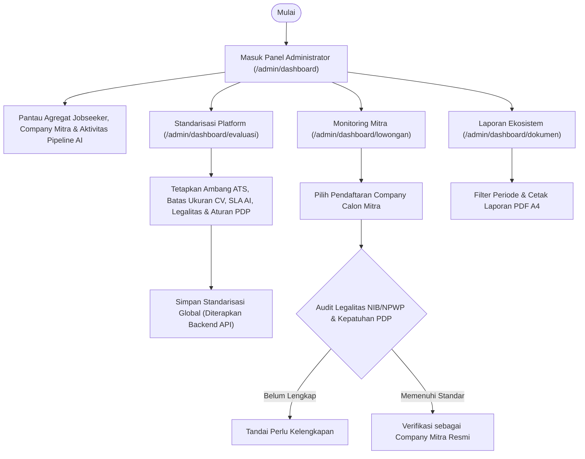

# Dokumentasi Detail Alur & Tugas Tiap Role - Pasbana AI

Dokumen ini menjelaskan secara terperinci kondisi teknis layanan, alur kerja (*workflow*), tugas utama, batasan wewenang, serta pemetaan halaman antarmuka untuk ketiga *role* pada platform **Pasbana AI**: **Jobseeker**, **Company (Employer)**, dan **Admin**.

---

## 1. Kondisi Teknis & Integrasi Layanan

1. **Frontend (`frontend/`, port `3000`)**: Antarmuka Next.js (App Router, TypeScript, Tailwind CSS) untuk Landing Page, Auth, serta portal dashboard tiga *role* (`Jobseeker`, `Company`, dan `Admin`).
2. **Backend API Utama (`backend-api/`, port `5000`)**: Layanan Express + TypeScript yang menangani autentikasi JWT (`bcryptjs`), otorisasi RBAC, skema PostgreSQL + `pgvector` (serta *local JSON vault* otomatis untuk pengembangan lokal), anonimisasi *blind screening* UU PDP, dan orkestrasi ke `backend-ai`. Lihat kontrak lengkap di [api-backend.md](api-backend.md).
3. **Backend AI (`backend-ai/`, port `8000`)**: Layanan internal FastAPI (`X-Internal-Token`) untuk ekstraksi PDF/DOCX, deteksi scan & dua kolom, sanitasi demografis UU PDP, penilaian ATS 5 dimensi, saran & embedding 1536d Gemini, serta pencocokan tahap 2 (`stage2`). Lihat catatan evaluasi teknis di [catatan-review-backend-ai.md](catatan-review-backend-ai.md).

---

## 2. Matriks Ringkasan Wewenang Tiap Role

| Aspek | Jobseeker (Pencari Kerja) | Company (Mitra Perusahaan) | Admin (Administrator Platform) |
| --- | --- | --- | --- |
| **Fokus Utama** | Evaluasi CV, peningkatan kesiapan ATS, dan melamar kerja | Publikasi lowongan mandiri, pengaturan *keywords*, dan seleksi pelamar | Standarisasi platform, audit pendaftaran company, dan pemantauan agregat |
| **Akses Data Pengguna** | Hanya data profil & dokumen CV miliknya sendiri | Kode ATS anonim + isi CV & profil terstruktur pelamar pada lowongannya | Hanya jumlah agregat jobseeker & company mitra (tanpa intervensi akun individu) |
| **Pengelolaan Lowongan** | Melihat rekomendasi & melamar lowongan aktif | CRUD lowongan perusahaan secara mandiri (via modal popup) | Tidak mengelola atau memoderasi isi lowongan company |
| **Audit & Verifikasi** | Validasi format dokumen CV (PDF/DOCX teks digital) sesuai standar Admin | Mengunggah legalitas usaha (NIB & NPWP) saat mendaftar | Mengaudit legalitas dan memverifikasi pendaftaran company calon mitra |
| **Standarisasi & Kepatuhan** | Menyetujui *consent* UU PDP saat registrasi/unggah CV | Wajib mematuhi standar *blind screening* & deskripsi loker | Menetapkan parameter standar global (ambang ATS, batas CV, aturan PDP) |

---

## 3. Role 1: Jobseeker (Pencari Kerja)

### 3.1 Tujuan & Tugas Utama
- Menekan tombol **Evaluasi CV Saya** atau **Belum Punya CV** pada Landing Page -> diarahkan ke halaman **Login** (`/login?next=...`) atau **Registrasi** (`/register`) apabila belum masuk.
- Menjawab popup **Pengecekan Awal CV** (*Sudah Punya CV* vs *Belum Punya CV*) saat pertama kali masuk ke halaman Evaluasi.
- **Skenario Sudah Punya CV**: Mengunggah berkas CV digital (PDF/DOCX berbasis teks) melalui area unggah di `/user/dashboard/evaluasi`.
- **Skenario Belum Punya CV**: Menyusun CV standar ATS 1-kolom dari nol melalui alur kuesioner terpandu di `/user/dashboard/evaluasi/onboarding` (tidak ditampilkan terpisah di sidebar, melainkan sub-alur dari Evaluasi CV).
- Meninjau hasil analisis dalam antarmuka **Chatbot Interaktif** (`/user/dashboard/hasil-evaluasi`) dengan badge pembeda sumber (`Hasil Unggah CV (PDF/DOCX)` vs `Hasil Onboarding CV Baru`), rekomendasi otomatis **Buat Ulang CV ATS** apabila terdeteksi kekurangan/skor `< 85`, serta akses langsung **Unduh / Dokumen CV ATS**.
- Mengelola detail profil CRUD (Identitas, Keahlian, Pengalaman, Pendidikan) dan meninjau/mengunduh PDF A4 pada **Dokumen CV ATS** (`/user/dashboard/dokumen`).
- Menjelajahi **Lowongan Cocok** hasil pencocokan skill CV dengan *keywords* perusahaan dan kualifikasi lowongan, lalu mengajukan lamaran.

### 3.2 Alur Kerja Detail Jobseeker

### 3.3 Pemetaan Halaman Antarmuka Jobseeker
- **Evaluasi CV** (`/user/dashboard/evaluasi` & `/evaluate`): Popup pengecekan awal kepemilikan CV, area unggah PDF/DOCX, dan tombol **Buka Halaman Onboarding**.
- **Onboarding CV** (`/user/dashboard/evaluasi/onboarding`): Sub-halaman Evaluasi CV (tanpa item terpisah di sidebar) untuk menyusun CV 1-kolom standar ATS dari 5 langkah kuesioner.
- **Hasil Evaluasi** (`/user/dashboard/hasil-evaluasi` & `/user/dashboard/riwayat/[id]`): Antarmuka **Chatbot Interaktif** (`CvEvaluationChat`), badge pembeda `Hasil Unggah CV (PDF/DOCX)` vs `Hasil Onboarding CV Baru`, banner rekomendasi otomatis **Buat Ulang CV ATS**, dan tombol **Unduh / Dokumen CV ATS**.
- **Dokumen CV ATS** (`/user/dashboard/dokumen`): Pratinjau lembar kertas A4 (210 x 297 mm), tombol **Edit Data** yang membuka popup modal langsung (`Identitas & Ringkasan`, `Keahlian & Alat`, `Pengalaman`, `Pendidikan`) untuk memperbarui isi CV seketika, serta tombol **Cetak / Unduh PDF**.
- **Lowongan Cocok** (`/user/dashboard/lowongan`, `/jobs`, & `/apply/[id]`): 3 tab (**Rekomendasi**, **Tersimpan**, **Lamaran Saya**), daftar lowongan terurut skor kecocokan skill terhadap kata kunci perusahaan, alasan kecocokan berkutipan CV, *missing skills*, dan pengajuan lamaran nyata via `/apply/[id]`.
- **Detail Profil & Privasi (Modal Header)**: CRUD terintegrasi API (`/api/profile`) untuk Identitas, Keahlian, Pengalaman, Pendidikan, serta tab **Privasi & CV** untuk hapus CV permanen (`DELETE /api/cvs/:id`) dan hapus akun permanen (`DELETE /api/users/me`).

---

## 4. Role 2: Company (Employer / Mitra Perusahaan)

### 4.1 Tujuan & Tugas Utama
- Mendaftarkan akun perusahaan beserta dokumen legalitas (NIB & NPWP) untuk diaudit dan diverifikasi oleh Admin.
- Memantau ringkasan metrik dan grafik analitik (`CompanyTrendDiagram` & `CompanyFunnelDiagram`) pada halaman utama dashboard.
- Membuat, mempublikasikan, menjeda, dan mengaktifkan lowongan kerja secara mandiri melalui modal popup **Pasang Lowongan** yang langsung terintegrasi ke dashboard pencari kerja.
- Meninjau seluruh pelamar masuk secara terpusat di **Seleksi Kandidat**, lengkap dengan skor ATS, alasan kecocokan AI, serta panel **Isi CV & Profil di Sistem** (`headline`, pendidikan, ringkasan pengalaman, *tags* skill, dan penanda `CV Unggahan` / `CV Onboarding`) dalam mode *blind screening* UU PDP.
- Mengelola identitas **Profil Perusahaan** termasuk **Kata Kunci Pencocokan (Keywords)** untuk menyelaraskan kebutuhan kompetensi perusahaan dengan skill pada CV pencari kerja.

### 4.2 Batasan Wewenang Company
- Hanya dapat mengakses lowongan milik perusahaannya sendiri dan kandidat yang melamar ke lowongan tersebut.
- Publikasi lowongan aktif mensyaratkan status kemitraan perusahaan telah `verified` oleh Admin dan mematuhi aturan *blind screening* UU PDP.

### 4.3 Alur Kerja Detail Company

### 4.4 Pemetaan Halaman Antarmuka Company
- **Beranda Perusahaan** (`/company/dashboard`): Ringkasan lowongan aktif, jumlah pelamar terkurasi, *shortlist*, modal popup `Pasang Lowongan`, `CompanyTrendDiagram`, dan `CompanyFunnelDiagram`.
- **Kelola Lowongan** (`/company/dashboard/lowongan`): Publikasi lowongan via modal popup (tanpa menggeser tata letak `100dvh`), jeda/aktifkan lowongan, dan diagram performa.
- **Seleksi Kandidat** (`/company/dashboard/evaluasi`): Daftar pelamar lintas lowongan dengan filter status, skor ATS, alasan kecocokan AI, panel **Isi CV & Profil di Sistem**, dan tombol aksi solid (`Tinjau`, `Shortlist`, `Tolak`).
- **Profil Perusahaan** (`/company/dashboard/dokumen`): Pengaturan nama perusahaan, bidang industri, website utama, lokasi, **Kata Kunci Pencocokan (Keywords)**, deskripsi perusahaan, serta pratinjau kartu mitra.

---

## 5. Role 3: Admin (Administrator Platform)

### 5.1 Tujuan & Tugas Utama
- **Melihat Data Agregat Ekosistem**: Memantau jumlah agregat `Jobseeker` terdaftar dan jumlah `Company` yang bekerja sama tanpa mengelola atau menonaktifkan akun pengguna individu.
- **Audit & Verifikasi Pendaftaran Company**: Mengaudit kelengkapan legalitas usaha (NIB & NPWP) serta kepatuhan *blind screening* UU PDP pada perusahaan yang mendaftar, lalu menetapkan status (`Verifikasi`, `Audit`, atau `Lengkapi`).
- **Menetapkan Standarisasi Global Platform**: Mengatur ambang skor minimum ATS, batas ukuran berkas CV (MB), format dokumen (`PDF & DOCX` / `PDF saja`), target SLA AI, kewajiban *blind screening* PDP, syarat legalitas *company*, dan retensi data CV.
- **Menyusun Laporan Eksekutif Ekosistem**: Memantau pertumbuhan agregat bulanan serta kepatuhan standar ekosistem dan mencetak laporan PDF A4.

### 5.2 Batasan Wewenang Admin
- **Tidak mengambil andil di dalam ranah internal company**: Admin tidak membuat, memoderasi, menyetujui, atau menolak lowongan kerja milik *company*, dan tidak ikut campur dalam proses seleksi pelamar perusahaan.
- **Tidak mengintervensi akun individu**: Admin hanya melihat metrik agregat pencari kerja dan mitra perusahaan.

### 5.3 Alur Kerja Detail Admin

### 5.4 Pemetaan Halaman Antarmuka Admin
- **Ringkasan Sistem** (`/admin/dashboard`): Angka agregat *real-time* dari `/api/admin/overview`, aksi cepat `Audit & Verifikasi Pendaftaran Company`, `AdminModerationDiagram`, dan `AdminPipelineDiagram`.
- **Monitoring Mitra** (`/admin/dashboard/lowongan`): Daftar pendaftaran *company* calon mitra dengan panel detail `Audit Legalitas`, `Kepatuhan PDP`, dan tombol solid (`Verifikasi`, `Audit`, `Lengkapi`).
- **Standarisasi Platform** (`/admin/dashboard/evaluasi`): Kartu agregat ekosistem, form `Parameter Standarisasi Global Platform` (`/api/admin/standards`), dan daftar `Standar Wajib Calon Mitra`.
- **Laporan Ekosistem** (`/admin/dashboard/dokumen`): Filter periode (`Bulan Ini`, `Kuartal`, `2026`), 4 kartu KPI eksekutif (`/api/admin/reports`), tabel pertumbuhan agregat 6 bulan terakhir, ringkasan kepatuhan standar, dan tombol `Cetak Laporan`.
