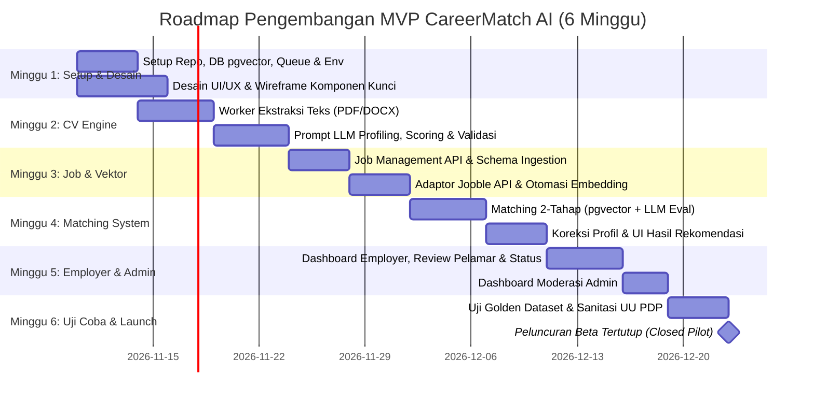

# CareerMatch AI — Implementation Tasks & Roadmap

Dokumen ini memuat rincian daftar tugas (*work breakdown structure*), roadmap peluncuran 6 minggu, checklist persiapan legal dan infrastruktur, serta pembagian tiket kerja teknis untuk repositori `frontend`, `backend-api`, dan `backend-ai`.

---

## 1. Kebutuhan Awal & Persiapan Proyek

### 1.1 Tim & Distribusi Peran Proyek
| Anggota Tim | NIM | Peran Utama | Lingkup Tanggung Jawab & Direktori |
| :--- | :--- | :--- | :--- |
| **Wira Fikri Ramadanu** | 23343023 | **Frontend Lead** | Direktori `frontend/`: Next.js (TS), Tailwind CSS, UI/UX flow, upload CV, visualisasi skor & rekomendasi loker |
| **Muhammad Gilang Ramadhan** | 23346013 | **Backend Lead** | Direktori `backend-api/`: Node.js (Express/TypeScript), PostgreSQL pgvector, Auth/RBAC, CRUD loker & lamaran, S3 storage |
| **Florensius Panca Gati** | 23343006 | **Backend AI Lead** | Direktori `backend-ai/`: Python (FastAPI), ekstraksi dokumen (PDF/DOCX), LLM parsing & scoring, vector embedding, matching engine |

### 1.2 Akun & Kredensial Layanan
- [ ] Inisialisasi Git Repository, perlindungan branch `main`, dan branching model (`feature/*`, `fix/*`).
- [ ] Penyediaan database PostgreSQL dengan ekstensi `pgvector` aktif (Supabase / Neon / Railway).
- [ ] Penyediaan bucket privat Object Storage (Supabase Storage / Cloudflare R2 / AWS S3).
- [ ] Registrasi API Key penyedia model AI (OpenAI / Gemini / Anthropic) dan model text-embedding.
- [ ] Pendaftaran API Key Jooble Publisher API (untuk penarikan data lowongan eksternal).
- [ ] Konfigurasi akun Sentry untuk pelacakan error aplikasi.
- [ ] Konfigurasi layanan email transaksional (Resend / Brevo) untuk verifikasi dan reset password.
- [ ] Pembuatan papan kerja tugas (Linear, GitHub Projects, atau Trello).

### 1.3 Dokumen Legal, Etika & Kepatuhan
- [ ] Draf teks Kebijakan Privasi (*Privacy Policy*) dan Syarat Ketentuan (*Terms of Service*) berstandar UU PDP.
- [ ] Draf teks persetujuan eksplisit (*Consent Form*) saat pertama kali pengguna mengunggah dokumen CV.
- [ ] Pedoman moderasi konten lowongan kerja untuk mencegah lowongan palsu, penipuan, atau pungutan liar.
- [ ] Surat permohonan penjajakan integrasi data ke Pasker ID / Kemnaker RI.

### 1.4 Penyusunan Data Uji (*Test Datasets*)
- [ ] Kumpulan 30–50 file CV anonim / sintetis (format PDF dan DOCX, bahasa Indonesia dan Inggris, lintas level pengalaman).
- [ ] Kumpulan 100+ data lowongan kerja uji coba (kombinasi data buatan dan respons API eksternal).
- [ ] **Golden Dataset:** 20 CV yang telah diberi skor manual oleh manusia terhadap 5 lowongan berbeda untuk mengevaluasi kualitas prompt matching LLM.

### 1.5 Estimasi Anggaran Operasional Bulanan Awal
| Komponen Layanan | Perkiraan Biaya (IDR) |
| :--- | :--- |
| Cloud Hosting, Database PostgreSQL & Storage (Free / Starter Tier) | Rp 0 – Rp 500.000 |
| Konsumsi Token LLM & Embedding (Skala Pengujian & Pilot) | Rp 100.000 – Rp 1.000.000 |
| Domain, Email Transaksional & Logging | Rp 50.000 – Rp 200.000 |
| **Total Estimasi Biaya Awal** | **Rp 150.000 – Rp 1.700.000 / bulan** |

---

## 2. Roadmap MVP (Timeline 6 Minggu)

### Kriteria Kelulusan Rilis Beta Tertutup (*Go-Live Gate*)
1. P95 latensi pemrosesan CV di bawah 60 detik.
2. Tidak ada kebocoran file CV (akses mutlak hanya melalui pre-signed URL terproteksi).
3. Pengujian Golden Dataset menunjukkan akurasi relevansi evaluasi LLM minimal 70%.
4. Alur hapus akun dan hapus CV terbukti membersihkan seluruh data terkait di database dan storage.

---

## 3. Checklist Tugas Teknis per Direktori Proyek

### 3.1 Direktori `frontend/` (Aplikasi Antarmuka Pengguna)
- [ ] **Setup Proyek & Styling:**
  - [ ] Inisialisasi Next.js (App Router, TypeScript) dengan Tailwind CSS dan Lucide Icons.
  - [ ] Implementasi token tema warna dan tipografi sesuai `docs/styleguide.md`.
  - [ ] Setup state management dan HTTP client (Axios / TanStack Query).
- [ ] **Autentikasi & Akun:**
  - [ ] Halaman Registrasi (pemilihan role `jobseeker` vs `employer`).
  - [ ] Halaman Login (Email/Password dan tombol Google OAuth).
  - [ ] Modal/Persetujuan Consent UU PDP sebelum aksi pengunggahan CV.
- [ ] **Modul Pencari Kerja (Job Seeker):**
  - [ ] Komponen drag-and-drop file upload CV dengan validasi format (.pdf/.docx, maks 5 MB).
  - [ ] Indikator progress bar pengunggahan dan status pemrosesan AI secara real-time.
  - [ ] Alert peringatan dokumen terbaca kosong jika pengguna mengunggah hasil scan foto.
  - [ ] Kartu visualisasi skor CV radial dengan rincian 5 dimensi evaluasi.
  - [ ] Kartu kelebihan, kelemahan, dan saran perbaikan resume.
  - [ ] Formulir koreksi manual profil hasil ekstraksi AI sebelum profil dikunci.
  - [ ] Halaman daftar lowongan rekomendasi berurut skor dengan kartu gap analysis (*missing skills*).
  - [ ] Tombol aksi lamar lowongan (*Quick Apply Internal* dan *Lamar di Sumber Eksternal*).
  - [ ] Halaman pengaturan akun untuk fitur hapus CV dan hapus akun permanen.
- [ ] **Modul Pemberi Kerja (Employer):**
  - [ ] Halaman profil perusahaan.
  - [ ] Formulir buat dan edit lowongan pekerjaan (judul, kriteria, gaji, lokasi, status kerja).
  - [ ] Dashboard lowongan aktif dan status publikasi.
  - [ ] Halaman daftar pelamar per lowongan yang diurutkan berdasarkan skor kecocokan tertinggi beserta ringkasan AI.
  - [ ] Kontrol perubahan status pelamar (*Reviewed*, *Shortlisted*, *Rejected*).
- [ ] **Modul Moderasi Admin:**
  - [ ] Antarmuka kurasi lowongan masuk (tombol Setujui, Tolak, Nonaktifkan).

---

### 3.2 Direktori `backend-api/` (Layanan Server & Database)
- [ ] **Setup Database & Migrasi:**
  - [ ] Setup koneksi PostgreSQL dan eksekusi ekstensi `CREATE EXTENSION IF NOT EXISTS vector;`.
  - [ ] Pembuatan skrip migrasi 10 tabel inti sesuai `docs/workflow.md` (`users`, `consents`, `cvs`, `cv_profiles`, `companies`, `jobs`, `matches`, `applications`, `saved_jobs`, `ai_usage_logs`).
  - [ ] Pembuatan indeks relasional dan indeks vektor HNSW pada kolom `embedding`.
- [ ] **Autentikasi, Otorisasi & Keamanan:**
  - [ ] Implementasi hashing kata sandi aman (bcrypt / Argon2).
  - [ ] Middleware proteksi endpoint berbasis JWT / sesi dan role (`jobseeker`, `employer`, `admin`).
  - [ ] Middleware rate limiting pada endpoint upload file dan autentikasi login.
  - [ ] Endpoint pencatatan persetujuan consent pengguna (`/api/consents`).
- [ ] **Penyimpanan Berkas (Storage Service):**
  - [ ] Klien object storage dengan kredensial privat.
  - [ ] Generator Pre-signed URL aman berumur terbatas (15 menit) untuk upload dan download file CV.
  - [ ] Validasi keamanan MIME type berkas sebelum disimpan ke bucket.
- [ ] **Endpoint Lowongan & Lamaran:**
  - [ ] Endpoint CRUD lowongan untuk employer (`/api/jobs`).
  - [ ] Endpoint pencarian lowongan dengan filter kata kunci, tipe kerja, dan lokasi.
  - [ ] Endpoint pengajuan lamaran kerja internal (`/api/applications`).
  - [ ] Endpoint pembaruan status pelamar oleh employer.
- [ ] **Kepatuhan Privasi (Right to be Forgotten):**
  - [ ] Endpoint penghapusan CV permanen (`DELETE /api/cvs/:id`) yang menghapus record DB dan file fisik storage.
  - [ ] Endpoint penghapusan akun pengguna menyeluruh (`DELETE /api/users/me`).

---

### 3.3 Direktori `backend-ai/` (Worker Pipeline & AI Service)
- [ ] **Infrastruktur Job Queue:**
  - [ ] Inisialisasi engine antrean latar belakang (`pg-boss` atau `BullMQ`).
  - [ ] Konfigurasi mekanisme auto-retry (maksimal 3 kali) dengan *exponential backoff*.
  - [ ] Pencatatan log aktivitas pemrosesan task ke database.
- [ ] **Layanan Ekstraksi Dokumen:**
  - [ ] Modul parser teks PDF menggunakan `pdf-parse` / `pdfjs-dist`.
  - [ ] Modul parser teks DOCX menggunakan `mammoth`.
  - [ ] Logika pengecekan teks kosong (mendeteksi dokumen scan gambar) untuk mengembalikan notifikasi error edukatif.
- [ ] **Layanan LLM Profiling & Scoring:**
  - [ ] Integrasi SDK penyedia LLM (OpenAI / Gemini / Anthropic).
  - [ ] Desain prompt ekstraksi profil CV dengan sanitasi atribut sensitif (tanpa gender, foto, agama, usia).
  - [ ] Enforcing skema JSON terstruktur (*structured outputs*) sesuai kontrak di `docs/workflow.md`.
  - [ ] Prompt penilaian kualitas CV (skor 0–100 dan pembagian 5 sub-aspek).
- [ ] **Layanan Vektor & Embedding:**
  - [ ] Modul pembuat vektor dari teks ringkasan profil menggunakan model embedding 1536-dimensi.
  - [ ] Modul pembuat vektor deskripsi dan kualifikasi lowongan pekerjaan baru.
  - [ ] Kueri kalkulasi jarak kemiripan cosinus pgvector (`<=>`) untuk mengambil Top 20–50 kandidat.
- [ ] **Engine Rekomendasi 2-Tahap (Matching Engine):**
  - [ ] Worker pipeline penggabungan Tahap 1 (Vektor) dan Tahap 2 (Evaluasi LLM).
  - [ ] Prompt evaluasi kecocokan kandidat: menghasilkan skor, narasi alasan, dan identifikasi *missing skills*.
  - [ ] Penyimpanan hasil evaluasi ke tabel `matches` dan caching respons.
- [ ] **Adaptor Sumber Lowongan Eksternal:**
  - [ ] Implementasi interface `JobSourceAdapter` untuk Jooble API.
  - [ ] Worker terjadwal (*cron job*) untuk menarik data lowongan baru secara periodik, menormalisasi data, dan men-generate vektor embedding.

---

## 4. Keputusan Mendesak & Tindakan Minggu Ini

### 4.1 Keputusan Kunci yang Harus Disepakati Tim
1. **Segmen Pasar Awal:** Memutuskan apakah peluncuran awal berfokus pada bidang teknologi/IT untuk fresh graduate atau terbuka umum ke seluruh bidang kerja.
2. **Aturan Verifikasi Employer:** Menentukan apakah akun employer wajib diverifikasi dokumen resmi (NIB/surat izin) sebelum diperbolehkan memasang lowongan internal.
3. **Masa Retensi CV:** Menyepakati batas waktu penyimpanan file CV pengguna non-aktif (usulan: 12 bulan sebelum auto-purge dengan notifikasi peringatan).

### 4.2 Tindakan Langsung Minggu Ini
- [ ] Tim menyelesaikan kesepakatan terhadap 3 keputusan kunci di atas.
- [ ] Push struktur repositori awal untuk `frontend/`, `backend-api/`, dan `backend-ai/`.
- [ ] Uji coba API Key Jooble untuk memeriksa volume lowongan yang tersedia di wilayah Indonesia.
- [ ] Rancang wireframe komponen UI kunci: upload CV, hasil evaluasi, dan kartu rekomendasi loker.

