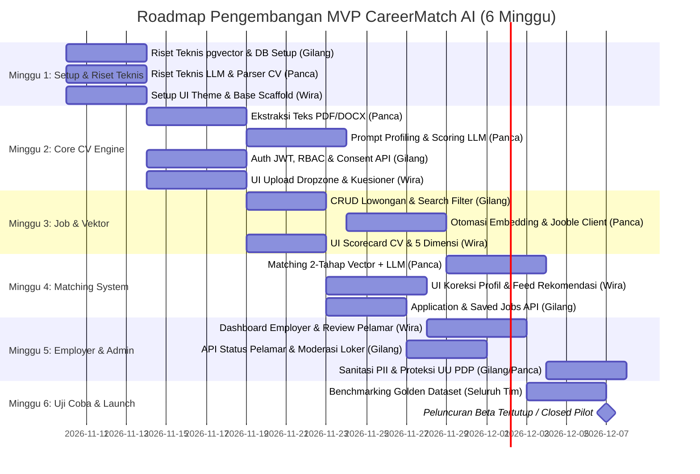

# CareerMatch AI (Pasbana) - Implementation Tasks & Pembagian Tugas Tim

Dokumen ini memuat rincian daftar tugas (*work breakdown structure*), status progres aktual, roadmap peluncuran 6 minggu, checklist persiapan infrastruktur, dan pembagian tugas lanjutan per anggota tim:
- **Wira Fikri Ramadanu (NIM: 23343023)** - *Frontend Lead* (`frontend/`)
- **Muhammad Gilang Ramadhan (NIM: 23346013)** - *Backend Lead* (`backend-api/`)
- **Florensius Panca Gati (NIM: 23343006)** - *Backend AI Lead* (`backend-ai/`)

> **Status Integrasi Terkini (Update 26 Nov 2026):**
> Ketiga layanan utama (`frontend/` port `3000`, `backend-api/` port `5000`, dan `backend-ai/` port `8000`) telah terintegrasi penuh secara lokal (`local-json-vault` + Gemini API + `149` unit test `pytest` lulus + `0` error TypeScript). Tugas yang tersisa pada daftar di bawah difokuskan pada aktivasi PostgreSQL `pgvector` produksi, Object Storage cloud, sinkronisasi live Jooble API, dan uji coba Golden Dataset.

---

## 1. Fase Riset Teknis (Technical Spikes & Feasibility)

Riset awal difokuskan secara eksklusif pada **riset teknis** untuk memvalidasi kelayakan arsitektur, pustaka, dan performa infrastruktur pada sisi **Backend AI** dan **Backend API**. Frontend tidak dibebani riset non-teknis dan dapat langsung fokus pada pengembangan antarmuka.

### 1.1 Riset Teknis Backend AI (Florensius Panca Gati)
- [x] **Benchmarking Model LLM Gratis (*Free Tier Feasibility*):**
  - Menguji latensi, kestabilan rate limit, mekanisme fallback model (`gemini-2.5-flash` / `gemini-2.0-flash`), dan kepatuhan skema JSON terstruktur (*Structured Outputs*) Google Gemini API.
  - Melakukan *prompt engineering spike* untuk ekstraksi 5 dimensi nilai CV, konsultasi chatbot interaktif, dan analisis teks kuesioner onboarding.
  - **[PIC: Florensius Panca Gati]**
- [x] **Eksplorasi Model Vektor & Embedding Teks:**
  - Evaluasi akurasi model embedding 1536-dimensi (`gemini-embedding-001`) untuk teks dwibahasa (Bahasa Indonesia & Inggris).
  - Pengujian skema jarak kemiripan kosinus (`cosineSimilarity` & kontrak `pgvector`).
  - **[PIC: Florensius Panca Gati]**
- [x] **Spike Parser Dokumen & Deteksi Scan Kosong:**
  - Uji performa pustaka `pdfplumber` dan `python-docx` terhadap berbagai tata letak CV (1 kolom, 2 kolom, tabel, serta *List Bullet* Microsoft Word).
  - Implementasi deteksi berkas gambar/scan tanpa layer teks digital (`is_scanned`) untuk mencegah pemrosesan sia-sia.
  - **[PIC: Florensius Panca Gati]**
- [x] **Eksplorasi Integrasi Jooble Publisher API:**
  - Merancang modul normalisasi payload Jooble (`normalize_jooble`) dan Arbeitnow ke skema standar `JobRecord`.
  - **[PIC: Florensius Panca Gati]** (Catatan: penarikan HTTP live menunggu `JOOBLE_API_KEY` produksi)

---

### 1.2 Riset Teknis Backend API (Muhammad Gilang Ramadhan)
- [x] **Eksplorasi Integrasi `pgvector` pada Node.js:**
  - Menyiapkan skema SQL 10 tabel dengan kolom `vector(1536)` di `backend-api/sql/schema.sql` serta driver `pg` dan fallback otomatis `local-json-vault` (`backend-api/data/db.json`).
  - **[PIC: Muhammad Gilang Ramadhan]**
- [x] **Arsitektur Pipeline Integrasi `backend-api` <-> `backend-ai`:**
  - Membangun orkestrasi layanan di `backend-api/src/services/aiService.ts` dengan timeout, fallback ATS-only, dan penggabungan skor Stage 1 (vektor kosinus) + Stage 2 (`MAX_CANDIDATES = 50`).
  - **[PIC: Muhammad Gilang Ramadhan]**
- [x] **Implementasi Sanitasi PII & Kepatuhan Teknis UU PDP:**
  - Integrasi sanitasi baris sensitif sebelum pemrosesan LLM, *blind screening* kode anonim pelamar di panel Company, serta endpoint hapus permanen CV (`DELETE /api/cvs/:id`).
  - **[PIC: Muhammad Gilang Ramadhan]**

---

## 2. Kebutuhan Fondasi & Persiapan Infrastruktur

### 2.1 Profil Tim & Area Tanggung Jawab Utama
| Anggota Tim | NIM | Peran Utama | Lingkup Tanggung Jawab & Direktori |
| :--- | :--- | :--- | :--- |
| **Wira Fikri Ramadanu** | 23343023 | **Frontend Lead** | Direktori `frontend/`: Next.js (TS), Tailwind CSS, UI/UX flow, upload CV, kuesioner tanpa CV, visualisasi skor & rekomendasi loker |
| **Muhammad Gilang Ramadhan** | 23346013 | **Backend Lead** | Direktori `backend-api/`: Node.js (Express/TypeScript), PostgreSQL pgvector, Auth/RBAC, CRUD loker & lamaran, S3 storage |
| **Florensius Panca Gati** | 23343006 | **Backend AI Lead** | Direktori `backend-ai/`: Python (FastAPI), ekstraksi dokumen, AI CV generator, LLM scoring, vector embedding, matching engine |

---

### 2.2 Persiapan Akun & Layanan Eksternal (PIC Ditugaskan)
- [x] Inisialisasi Git Repository, setup `.gitignore`, dan baseline project **[PIC: Seluruh Tim]**
- [ ] Penyediaan database PostgreSQL dengan ekstensi `pgvector` aktif (Supabase / Neon / Railway) **[PIC: Muhammad Gilang Ramadhan]**
- [ ] Penyediaan bucket privat Object Storage (Supabase Storage / Cloudflare R2 / AWS S3) **[PIC: Muhammad Gilang Ramadhan]**
- [ ] Konfigurasi akun Sentry (error tracking) dan Resend/Brevo (email transaksional) **[PIC: Muhammad Gilang Ramadhan]**
- [x] Konfigurasi akun API Key penyedia model AI (Google Gemini API & `gemini-embedding-001`) di `backend-ai/.env` **[PIC: Florensius Panca Gati]**
- [ ] Pendaftaran API Key Jooble Publisher API untuk agregasi lowongan kerja **[PIC: Florensius Panca Gati]**
- [ ] Setup board manajemen tugas (GitHub Projects / Trello / Linear) **[PIC: Wira Fikri Ramadanu]**

---

### 2.3 Dokumen Legal, Privasi & Kepatuhan UU PDP
- [ ] Draf teks Kebijakan Privasi (*Privacy Policy*) & Syarat Ketentuan (*ToS*) berstandar UU PDP **[PIC: Muhammad Gilang Ramadhan & Wira Fikri Ramadanu]**
- [ ] Draf formulir persetujuan eksplisit (*Consent Form*) saat pertama kali pengguna mengunggah CV **[PIC: Wira Fikri Ramadanu]**
- [ ] Aturan moderasi konten lowongan kerja untuk mencegah loker palsu/penipuan **[PIC: Muhammad Gilang Ramadhan]**
- [ ] Surat permohonan kemitraan data resmi ke Pasker ID / Kemnaker RI **[PIC: Seluruh Tim]**

---

### 2.4 Penyusunan Data Uji (*Test Datasets*)
- [ ] Pengumpulan 30–50 contoh berkas CV anonim/sintetis (.pdf dan .docx, ID & EN) **[PIC: Florensius Panca Gati]**
- [ ] Pengumpulan 100+ sampel data lowongan kerja (internal & hasil Jooble) **[PIC: Florensius Panca Gati]**
- [ ] **Golden Dataset:** 20 CV yang dinilai manual oleh manusia untuk benchmarking akurasi matching AI **[PIC: Seluruh Tim]**

---

### 2.5 Strategi Anggaran & Biaya Operasional (100% Gratis / Zero Budget)
Seluruh infrastruktur dan layanan eksternal MVP dirancang memanfaatkan paket gratis (*Free Tier / Free Community Credits*), sehingga total anggaran operasional adalah **Rp 0 (Sepenuhnya Gratis)**:

| Komponen Layanan | Penyedia Layanan & Skema Gratis | Biaya (IDR) | Penanggung Jawab Monitoring |
| :--- | :--- | :--- | :--- |
| **Web Frontend Hosting** | Vercel Hobby Plan (Gratis untuk Next.js) | **Rp 0** | Wira Fikri Ramadanu |
| **Database & pgvector** | Supabase Free Tier / Neon Postgres Free Tier (Termasuk 500 MB & pgvector) | **Rp 0** | Muhammad Gilang Ramadhan |
| **File Storage CV** | Supabase Storage Free Tier (Kapasitas 1 GB gratis) / Cloudflare R2 Free (10 GB) | **Rp 0** | Muhammad Gilang Ramadhan |
| **Backend API Hosting** | Render / Railway / Koyeb Free Tier | **Rp 0** | Muhammad Gilang Ramadhan |
| **Backend AI Hosting** | Render / Hugging Face Spaces / Lokal Development Free | **Rp 0** | Florensius Panca Gati |
| **Model AI & Embedding** | Google Gemini API (Free Tier: 15 RPM gratis) & Hugging Face Inference API | **Rp 0** | Florensius Panca Gati |
| **Job Aggregator API** | Jooble Publisher API (Akses Publisher Gratis dengan API Key) | **Rp 0** | Florensius Panca Gati |
| **Email Transaksional** | Resend Free Plan (Gratis hingga 3.000 email/bulan) | **Rp 0** | Muhammad Gilang Ramadhan |
| **Monitoring & Error Logging**| Sentry Developer Plan (Gratis hingga 5.000 event error/bulan) | **Rp 0** | Muhammad Gilang Ramadhan |
| **Domain & DNS** | Subdomain gratis Vercel (`*.vercel.app`) / GitHub Pages | **Rp 0** | Wira Fikri Ramadanu |
| **TOTAL BIAYA MVP** | **Zero Budget Strategy (100% Free Tier)** | **Rp 0** | **Seluruh Tim** |

---

## 3. Roadmap MVP & Pembagian Milestones (6 Minggu)

> 🎨 **Diagram Desain Interaktif:** [Buka Versi HTML Interaktif](diagrams/roadmap-mvp.html) · [Buka Berkas Vektor SVG](diagrams/roadmap-mvp.svg)

Lihat Notasi Kode Gantt (Mermaid Timeline)

---

## 4. Checklist Tugas Rinci per Anggota Tim

### 4.1 Wira Fikri Ramadanu (NIM: 23343023) — *Frontend Lead*
> **Direktori Kerja:** `frontend/`  
> **Teknologi:** Next.js (App Router, TypeScript), Tailwind CSS, Lucide Icons, TanStack Query

#### A. Setup & Desain Sistem UI
- [x] Inisialisasi Next.js 14, Tailwind CSS, Lucide React, dan TypeScript config
- [x] Konfigurasi token warna tema (`primary`, `match-high`, `match-medium`, `match-low`) sesuai `docs/styleguide.md`
- [x] Setup HTTP Client (`src/lib/api.ts`) dengan penanganan token JWT dan error boundary
- [x] Implementasi responsivitas mobile-first (touch area minimal $44 \times 44\text{ px}$, navbar drawer/menu)

#### B. Modul Autentikasi & Akun Pengguna
- [x] Halaman Pendaftaran (*Register* di `/register`) dengan opsi seleksi role: `jobseeker` vs `employer`
- [x] Halaman Masuk (*Login* di `/login`) dengan email/password
- [x] Modal dialog Persetujuan Consent Pemrosesan Data Pribadi (UU PDP) sebelum unggah CV
- [x] Tab **Privasi & CV** pada popup profil pengguna: tombol hapus permanen dokumen CV (`DELETE /api/cvs/:id`, *Right to be Forgotten*)

#### C. Modul Pencari Kerja (Job Seeker)
- [x] Routing dashboard berbasis role (`/[role]/dashboard/*` untuk `user`, `company`, dan `admin` beserta sub-route `evaluasi`, `onboarding`, `dokumen`, `lowongan`, dan `riwayat/[id]`)
- [x] Halaman Evaluasi CV (`/user/dashboard/evaluasi`) dengan Drag-and-Drop Dropzone (.pdf / .docx maks 5 MB), validasi scan gambar, dan pintasan menuju Onboarding CV
- [x] Halaman Onboarding CV (`/user/dashboard/onboarding`) dengan halaman pengantar terpisah sebelum memulai *Multi-step Form Wizard* 5 langkah (Identitas, Pendidikan, Target Peran, Skill, Pengalaman/Proyek)
- [x] Halaman Riwayat Sesi & Konsultasi AI (`/user/dashboard/riwayat/[id]`) yang menyimpan hasil evaluasi/onboarding nyata (tanpa data dummy), menampilkan Circular Score Gauge (0–100), Diagram Radar 5 Dimensi, kartu solid Kekuatan Utama & Rekomendasi Perbaikan, serta chat konsultasi AI interaktif
- [x] Halaman Dokumen CV ATS (`/user/dashboard/dokumen`) dengan pratinjau lembar ukuran A4 (210 x 297 mm), card keterangan dokumen, panduan cetak PDF, kelengkapan bagian CV, serta tombol aksi **Edit Data** dan **Cetak / Unduh PDF**
- [x] Halaman Lowongan Cocok (`/user/dashboard/lowongan`) dengan badge sumber (*Internal* vs *Jooble*), alasan kecocokan, label *missing skills*, serta tombol lamar ke `/apply/[id]` (internal) dan portal eksternal
- [x] Fitur simpan/bookmark lowongan untuk dibaca nanti (*Saved Jobs*)

#### D. Modul Pemberi Kerja (Company / Employer)
- [x] Formulir profil perusahaan (nama perusahaan, bidang industri, website, lokasi, *keywords* pencocokan skill, dan deskripsi) di `/company/dashboard/dokumen`
- [x] Modal popup pembuatan lowongan pekerjaan (judul, tipe kerja, lokasi, dan sinkronisasi *keywords* perusahaan) di `/company/dashboard` dan `/company/dashboard/lowongan`
- [x] Dashboard manajemen daftar lowongan aktif, toggle jeda/aktif, serta diagram analitik tren & funnel pelamar
- [x] Halaman daftar pelamar masuk (`/company/dashboard/evaluasi`) yang diurutkan otomatis berdasarkan skor kecocokan tertinggi dengan kode ATS anonim (*blind screening*)
- [x] Panel detail isi CV & profil pelamar di sistem serta ringkasan kecocokan AI tanpa atribut sensitif
- [x] Kontrol pembaruan status pelamar (*Reviewed*, *Shortlisted*, *Rejected*)

#### E. Modul Administrator Platform (Admin)
- [x] Dashboard ringkasan agregat jumlah *jobseeker* & *company* mitra serta tren pipeline AI (`/admin/dashboard`)
- [x] Halaman audit & verifikasi pendaftaran *company* calon mitra beserta kelengkapan legalitas NIB/NPWP (`/admin/dashboard/lowongan`)
- [x] Halaman pengaturan standarisasi global platform (ambang ATS, batas ukuran CV, format dokumen, aturan *blind screening*, dan retensi data) di `/admin/dashboard/evaluasi`
- [x] Halaman laporan eksekutif ekosistem & cetak PDF A4 (`/admin/dashboard/dokumen`)

---

### 4.2 Muhammad Gilang Ramadhan (NIM: 23346013) - *Backend Lead*
> **Direktori Kerja:** `backend-api/`  
> **Teknologi:** Node.js, Express (TypeScript), PostgreSQL, pgvector, JWT, Helmet, bcryptjs

#### A. Riset Teknis Backend API (pgvector & Pipeline Asinkron)
- [x] Menyiapkan driver `pg` Node.js dan skema `vector(1536)` di `backend-api/sql/schema.sql` serta fallback `local-json-vault`
- [x] Membangun orkestrasi pemanggilan HTTP ke `backend-ai` (`aiService.ts`) lengkap dengan timeout, fallback deterministik, dan pencocokan 2-tahap
- [x] Menerapkan proteksi privasi *blind screening* dan mekanisme hapus permanen dokumen CV (`DELETE /api/cvs/:id`)
- [ ] Uji coba mekanisme *pre-signed URL* upload file privat Object Storage cloud (kedaluwarsa 15 menit) untuk deployment produksi

#### B. Database & Infrastruktur Penyimpanan
- [x] Pembuatan skrip migrasi SQL tabel inti + ekstensi `vector` (`backend-api/sql/schema.sql`)
- [ ] Provisioning database PostgreSQL cloud (`Supabase` / `Neon`) dan mengaktifkan koneksi `DATABASE_URL` produksi
- [ ] Setup koneksi Object Storage cloud (`S3` / `Cloudflare R2` / `Supabase Storage`) untuk menggantikan vault lokal `backend-api/uploads/`

#### C. Keamanan, Autentikasi & Kepatuhan PDP
- [x] Implementasi hashing kata sandi aman menggunakan `bcryptjs`
- [x] Endpoint pendaftaran pengguna (`POST /api/auth/register`) dengan validasi role (`jobseeker`/`user`, `employer`/`company`) dan legalitas mitra
- [x] Endpoint masuk pengguna (`POST /api/auth/login`) yang menghasilkan token JWT terproteksi
- [x] Middleware otentikasi JWT dan otorisasi role (*Role-Based Access Control / RBAC*)
- [x] Middleware proteksi keamanan (*Helmet* & *CORS*)
- [ ] Tambahkan *Rate Limiting* ketat pada rute upload CV & login untuk environment produksi
- [x] Endpoint pencatatan persetujuan data pribadi (`pdpConsent`) saat registrasi
- [x] Endpoint penerimaan data kuesioner profil bagi pengguna tanpa CV (`POST /api/cvs/from-questionnaire` terhubung ke `/internal/v1/cv/analyze-text`)
- [x] Endpoint konsultasi chatbot evaluasi CV (`POST /api/cvs/chat` terhubung ke `/internal/v1/cv/chat`)
- [x] Endpoint penghapusan berkas CV permanen (`DELETE /api/cvs/:id`)
- [ ] Endpoint penghapusan akun pengguna menyeluruh (`DELETE /api/users/me`)

#### D. API Manajemen Lowongan Kerja & Company (`Jobs & Company API`)
- [x] Endpoint pembuatan lowongan kerja oleh employer (`POST /api/jobs` & `POST /api/company/jobs`) lengkap dengan pembuatan `jobEmbedding` via `/internal/v1/embed`
- [x] Endpoint pembacaan daftar lowongan dengan filter kata kunci, lokasi, dan tipe kerja (`GET /api/jobs`) serta rekomendasi terurut AI (`GET /api/jobs/recommendations`)
- [x] Endpoint jeda/aktifkan lowongan (`PATCH /api/company/jobs/:id`) dan manajemen profil perusahaan (`GET/PUT /api/company/profile`)
- [ ] Logika deduplikasi lowongan eksternal & scheduled job auto-hide untuk lowongan kedaluwarsa (`expires_at`)

#### E. API Pengajuan Lamaran & Employer Review
- [x] Endpoint pengajuan lamaran kerja internal (`POST /api/applications`)
- [x] Endpoint peninjauan daftar pelamar lintas lowongan terurut skor ATS dalam mode *blind screening* (`GET /api/company/applicants`)
- [x] Endpoint pengubahan status pelamar oleh employer (`PATCH /api/company/applicants/:id/status`)
- [ ] Endpoint simpan dan hapus bookmark lowongan di sisi backend (`POST/DELETE /api/saved-jobs/:jobId`)

#### F. API Administrator Platform (Admin)
- [x] Endpoint ringkasan agregat ekosistem & pipeline AI (`GET /api/admin/overview`)
- [x] Endpoint audit & verifikasi pendaftaran perusahaan mitra (`GET /api/admin/partners`, `PATCH /api/admin/partners/:id/audit`)
- [x] Endpoint standarisasi global platform (`GET/PUT /api/admin/standards`) dan laporan eksekutif (`GET /api/admin/reports`)

---

### 4.3 Florensius Panca Gati (NIM: 23343006) - *Backend AI Lead*
> **Direktori Kerja:** `backend-ai/`  
> **Teknologi:** Python 3.11+, FastAPI, Pydantic v2, pdfplumber, python-docx, Google GenAI SDK (`gemini-2.5-flash`, `gemini-embedding-001`)

#### A. Riset Teknis Backend AI (LLM, Parser & Embedding)
- [x] Pengujian model Google Gemini API untuk latency, fallback model otomatis saat `404`, dan kestabilan structured JSON
- [x] Eksperimen ekstraksi teks CV berbagai layout (`.pdf` / `.docx`) dan deteksi scan foto kosong (`is_scanned`)
- [x] Perancangan prompt AI evaluasi CV, konsultasi chatbot, dan analisis teks kuesioner onboarding
- [x] Evaluasi model embedding 1536-dimensi (`gemini-embedding-001`) dwibahasa
- [x] Uji coba format normalisasi payload Jooble (`normalize_jooble`) dan Arbeitnow

#### B. Layanan Ekstraksi Teks Dokumen
- [x] Inisialisasi FastAPI, struktur Pydantic schemas, dan proteksi `X-Internal-Token`
- [x] Modul pembaca berkas PDF menggunakan `pdfplumber` dengan deteksi multi-kolom, tabel, gambar, dan scan kosong
- [x] Modul pembaca berkas DOCX menggunakan `python-docx` termasuk deteksi gaya *List Bullet* bawaan Word
- [x] Endpoint pemeriksaan ATS (`POST /internal/v1/cv/ats-check`), analisis lengkap file (`POST /internal/v1/cv/analyze`), dan analisis teks onboarding (`POST /internal/v1/cv/analyze-text`)

#### C. Sanitasi PII, Profil Terstruktur & Chatbot AI Bebas Bias
- [x] Fungsi pembersih data sensitif (`app/sanitization/sanitizer.py`) untuk menyaring label demografis UU PDP sebelum teks dikirim ke LLM
- [x] Implementasi *AI Blind Scoring* tanpa parameter usia, gender, agama, suku, atau status pernikahan
- [x] Ekstraktor profil terstruktur (`app/profile/extractor.py`) yang mengembalikan `fullName`, `headline`, `contactEmail`, `summary`, `skills` (`technical`/`soft`/`tools`), `experiences`, dan `education`
- [x] Penilaian kualitas CV 5 dimensi + `general_skill_score`, perbaikan regex kata kunci simbol (`C#`, `C++`), dan generator `strengths[]` deterministik
- [x] Endpoint konsultasi chatbot interaktif (`POST /internal/v1/cv/chat`) dengan pembatasan konteks CV/karir dan fallback deterministik

#### D. Layanan Vektor & Text Embedding
- [x] Klien model embedding teks 1536-dimensi (`GeminiEmbedder`)
- [x] Pembuatan vektor otomatis untuk teks CV tersanitasi pada `/internal/v1/cv/analyze` dan `/internal/v1/cv/analyze-text`
- [x] Endpoint HTTP batch embedding (`POST /internal/v1/embed`) untuk kebutuhan vektor lowongan kerja di `backend-api`

#### E. Mesin Pencocokan Dua Tahap (Two-Stage Matching Engine)
- [x] Perluasan kamus keahlian lintas bidang menjadi **68 skill** (`skills.yaml` & `skill_labels.yaml`) serta pengisian `heading_aliases.yaml` dan `keyword_synonyms.yaml`
- [x] Endpoint `POST /internal/v1/match/stage2` dengan kapasitas **`MAX_CANDIDATES = 50`**, skor kecocokan 0-100, *verdict*, kutipan bukti (`evidence_in_text`), *missing_skills*, dan dukungan pencocokan *keywords* kustom perusahaan di luar kamus YAML
- [x] Verifikasi menyeluruh dengan **`149` unit test `pytest` lulus 100%**

#### F. Adaptor Penarikan Lowongan Eksternal
- [x] Modul normalisasi skema respons **Jooble** (`normalize_jooble`) dan **Arbeitnow** (`app/jobs/normalizer.py`)
- [ ] Implementasi klien HTTP live Jooble Publisher API (`JOOBLE_API_KEY`) dan cron job sinkronisasi periodik ke `backend-api`

---

## 5. Keputusan Kunci & Pembagian Tugas Lanjutan per Anggota Tim

### 5.1 Keputusan Prioritas Tim
1. **Lingkup Role Admin:** Admin berfokus pada agregat ekosistem, audit/verifikasi legalitas perusahaan calon mitra, standarisasi global, dan laporan eksekutif (tidak memoderasi lowongan atau seleksi pelamar internal milik perusahaan).
2. **Alur Onboarding & Evaluasi:** Halaman Onboarding ditempatkan sebagai sub-alur Evaluasi CV (`/user/dashboard/evaluasi/onboarding`), sedangkan hasil analisis ditampilkan di antarmuka Chatbot Interaktif (`/user/dashboard/hasil-evaluasi`) lengkap dengan pembeda sumber CV dan rekomendasi buat ulang di `/user/dashboard/dokumen`.
3. **Masa Retensi CV:** Mengikuti pengaturan standar global Admin (`retentionDays`, default 90 hari; dapat disesuaikan hingga 12 bulan sebelum *auto-purge*).

### 5.2 Tugas Lanjutan Masing-Masing Anggota Tim (Sprint Berikutnya)
- **Wira Fikri Ramadanu (`frontend/`):**
  - Menambahkan tombol aksi hapus CV permanen & hapus akun di popup profil pengguna agar terhubung ke `DELETE /api/cvs/:id` dan `DELETE /api/users/me`.
  - Menghubungkan fitur *Saved Jobs* pada halaman Lowongan Cocok agar tersimpan persisten ke database backend (tidak hanya `localStorage`).
  - Melakukan uji coba end-to-end UI seluruh role (`user`, `company`, `admin`) pada viewport desktop dan mobile.
- **Muhammad Gilang Ramadhan (`backend-api/`):**
  - Menghubungkan PostgreSQL cloud (`Supabase` / `Neon`) dengan ekstensi `pgvector` aktif agar menggantikan `local-json-vault` di environment produksi.
  - Memindahkan penyimpanan berkas fisik CV dari `backend-api/uploads/` ke Object Storage privat (Supabase Storage / Cloudflare R2) dengan *pre-signed URL*.
  - Menambahkan *rate limiting* (`express-rate-limit`), endpoint `DELETE /api/users/me`, serta endpoint bookmark lowongan (`/api/saved-jobs`).
- **Florensius Panca Gati (`backend-ai/`):**
  - Menambahkan klien HTTP live Jooble Publisher API menggunakan `JOOBLE_API_KEY` dan skrip sinkronisasi periodik lowongan Indonesia + pembuatan embedding otomatis.
  - Melakukan *benchmarking* akurasi pencocokan & skor ATS menggunakan **Golden Dataset (20 CV uji)** bersama seluruh tim sebelum rilis Beta.
