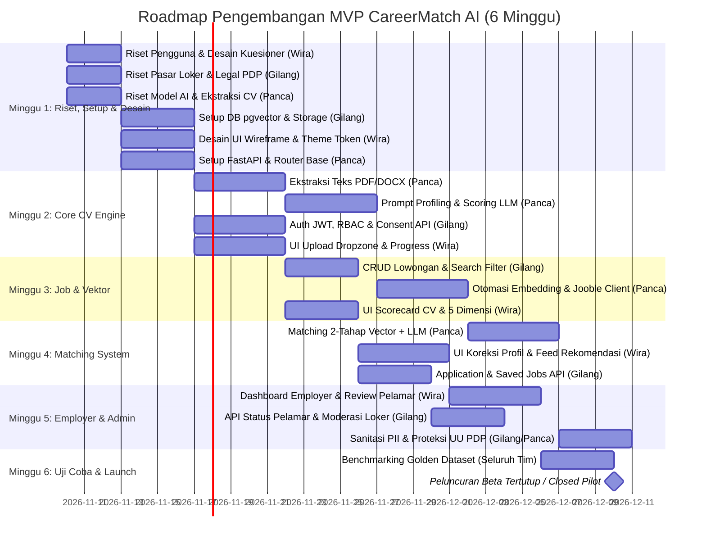

# CareerMatch AI — Implementation Tasks & Pembagian Tugas Tim

Dokumen ini memuat rincian daftar tugas (*work breakdown structure*), roadmap peluncuran 6 minggu, checklist persiapan infrastruktur, dan pembagian tugas per anggota tim:
- **Wira Fikri Ramadanu (NIM: 23343023)** — *Frontend Lead* (`frontend/`)
- **Muhammad Gilang Ramadhan (NIM: 23346013)** — *Backend Lead* (`backend-api/`)
- **Florensius Panca Gati (NIM: 23343006)** — *Backend AI Lead* (`backend-ai/`)

---

## 1. Fase Riset & Validasi Kebutuhan Awal (Discovery & Research Phase)

Sebelum pengembangan teknis dilakukan, seluruh tim menjalankan serangkaian riset pengguna, pasar, teknis AI, dan regulasi hukum guna memastikan solusi yang dibangun tepat sasaran dan berdasar pada data nyata.

### 1.1 Riset Pengguna & Kebutuhan Fitur (*User Discovery*)
- [ ] **Wawancara Pencari Kerja & Fresh Graduate (10–15 Responden):**
  - Mengidentifikasi hambatan utama dalam melamar kerja, alasan CV sering diabaikan, dan kendala pelamar yang belum memiliki CV sama sekali.
  - Menguji pemahaman pengguna terhadap konsep skor ATS dan rekomendasi lowongan berbasis AI.
  - **[PIC: Wira Fikri Ramadanu]**
- [ ] **Formulasi Pertanyaan Kuesioner Terpandu (*Guided Questions Design*):**
  - Riset struktur pertanyaan paling efektif untuk pengguna tanpa CV: identifikasi latar belakang pendidikan, kompetensi teknis & non-teknis, riwayat organisasi/magang/proyek kampus, serta preferensi bidang kerja.
  - Menyusun urutan langkah formulir wizard agar ringkas, mudah dipahami, dan selesai diisi dalam waktu $< 5$ menit.
  - **[PIC: Wira Fikri Ramadanu]**
- [ ] **Wawancara Kebutuhan Rekruter & UMKM (3–5 Responden):**
  - Menggali kriteria utama screening CV yang digunakan HR/pemilik usaha saat menyaring pelamar entry-level.
  - Memvalidasi 5 dimensi penilaian kualitas CV (struktur, kejelasan, pencapaian terukur, relevansi skill, kelengkapan).
  - **[PIC: Muhammad Gilang Ramadhan & Wira Fikri Ramadanu]**

---

### 1.2 Riset Pasar & Benchmarking Kompetitor (*Market Research*)
- [ ] **Analisis Kompetitor & Solusi Serupa:**
  - Mempelajari alur dan fitur platform lokal (Jobstreet, Glints, KitaLulus) dan AI resume builder global (Rezi, Teal, Jobscan).
  - Menentukan pembeda utama (*unique value proposition*) CareerMatch AI: analisis gratis, pembuatan CV otomatis dari kuesioner, dan pencocokan lowongan dua tahap.
  - **[PIC: Muhammad Gilang Ramadhan]**
- [ ] **Riset Cakupan Data Lowongan Kerja Eksternal:**
  - Melakukan uji coba kueri API Jooble untuk wilayah kota-kota besar di Indonesia (Jakarta, Surabaya, Bandung, Yogyakarta, Medan, dsb.).
  - Memeriksa kelengkapan metadata lowongan: judul posisi, deskripsi, syarat skill, lokasi, dan URL asli lamaran.
  - **[PIC: Florensius Panca Gati]**

---

### 1.3 Riset Teknis AI & Eksplorasi Model (*Technical Spikes*)
- [ ] **Benchmarking Model LLM Gratis (*Free Tier Feasibility*):**
  - Pengujian performa Google Gemini API (Free Tier: 15 RPM) vs alternatif open-source/free untuk akurasi ekstraksi profil dan kecepatan scoring.
  - Pengujian prompt AI CV Generator: menguji kualitas resume yang dihasilkan dari sampel jawaban kuesioner dummy.
  - **[PIC: Florensius Panca Gati]**
- [ ] **Riset Model Embedding & Algoritma Vektor:**
  - Evaluasi akurasi model embedding 1536-dimensi untuk teks dwibahasa (Bahasa Indonesia & Bahasa Inggris).
  - Pengujian kueri jarak kemiripan cosinus pgvector (`<=>`) pada PostgreSQL lokal.
  - **[PIC: Florensius Panca Gati]**
- [ ] **Eksplorasi Parser Dokumen CV:**
  - Menguji pustaka `pypdf` dan `python-docx` terhadap 10 ragam format CV (1 kolom, 2 kolom, tabel, format kreatif) dan mengidentifikasi penanganan file scan foto kosong.
  - **[PIC: Florensius Panca Gati]**

---

### 1.4 Riset Regulasi & Kepatuhan Hukum UU PDP
- [ ] **Kajian Kepatuhan UU Perlindungan Data Pribadi (UU No. 27 Tahun 2022):**
  - Menentukan mekanisme persetujuan eksplisit (*opt-in consent*) saat mengunggah atau membuat CV.
  - Menetapkan kebijakan sanitasi data sensitif (PII: NIK, nomor telepon, alamat detail) sebelum diteruskan ke API LLM.
  - Merancang prosedur hak hapus permanen (*Right to be Forgotten*) untuk akun dan berkas CV.
  - **[PIC: Muhammad Gilang Ramadhan]**

---

---

## 2. Kebutuhan Fondasi & Persiapan Infrastruktur

### 2.1 Profil Tim & Area Tanggung Jawab Utama
| Anggota Tim | NIM | Peran Utama | Lingkup Tanggung Jawab & Direktori |
| :--- | :--- | :--- | :--- |
| **Wira Fikri Ramadanu** | 23343023 | **Frontend Lead** | Direktori `frontend/`: Next.js (TS), Tailwind CSS, UI/UX flow, upload CV, kuesioner tanpa CV, visualisasi skor & rekomendasi loker |
| **Muhammad Gilang Ramadhan** | 23346013 | **Backend Lead** | Direktori `backend-api/`: Node.js (Express/TypeScript), PostgreSQL pgvector, Auth/RBAC, CRUD loker & lamaran, S3 storage |
| **Florensius Panca Gati** | 23343006 | **Backend AI Lead** | Direktori `backend-ai/`: Python (FastAPI), ekstraksi dokumen, AI CV generator, LLM scoring, vector embedding, matching engine |

---

### 2.2 Persiapan Akun & Layanan Eksternal (PIC Ditugaskan)
- [x] Inisialisasi Git Repository, setup `.gitignore`, dan baseline project **[PIC: Seluruh Tim]**
- [ ] Penyediaan database PostgreSQL dengan ekstensi `pgvector` aktif (Supabase / Neon / Railway) **[PIC: Muhammad Gilang Ramadhan]**
- [ ] Penyediaan bucket privat Object Storage (Supabase Storage / Cloudflare R2 / AWS S3) **[PIC: Muhammad Gilang Ramadhan]**
- [ ] Konfigurasi akun Sentry (error tracking) dan Resend/Brevo (email transaksional) **[PIC: Muhammad Gilang Ramadhan]**
- [ ] Registrasi API Key penyedia model AI (OpenAI / Gemini / Anthropic) dan embedding **[PIC: Florensius Panca Gati]**
- [ ] Pendaftaran API Key Jooble Publisher API untuk agregasi lowongan kerja **[PIC: Florensius Panca Gati]**
- [ ] Setup board manajemen tugas (GitHub Projects / Trello / Linear) **[PIC: Wira Fikri Ramadanu]**

---

### 2.3 Dokumen Legal, Privasi & Kepatuhan UU PDP
- [ ] Draf teks Kebijakan Privasi (*Privacy Policy*) & Syarat Ketentuan (*ToS*) berstandar UU PDP **[PIC: Muhammad Gilang Ramadhan & Wira Fikri Ramadanu]**
- [ ] Draf formulir persetujuan eksplisit (*Consent Form*) saat pertama kali pengguna mengunggah CV **[PIC: Wira Fikri Ramadanu]**
- [ ] Aturan moderasi konten lowongan kerja untuk mencegah loker palsu/penipuan **[PIC: Muhammad Gilang Ramadhan]**
- [ ] Surat permohonan kemitraan data resmi ke Pasker ID / Kemnaker RI **[PIC: Seluruh Tim]**

---

### 2.4 Penyusunan Data Uji (*Test Datasets*)
- [ ] Pengumpulan 30–50 contoh berkas CV anonim/sintetis (.pdf dan .docx, ID & EN) **[PIC: Florensius Panca Gati]**
- [ ] Pengumpulan 100+ sampel data lowongan kerja (internal & hasil Jooble) **[PIC: Florensius Panca Gati]**
- [ ] **Golden Dataset:** 20 CV yang dinilai manual oleh manusia untuk benchmarking akurasi matching AI **[PIC: Seluruh Tim]**

---

### 2.5 Strategi Anggaran & Biaya Operasional (100% Gratis / Zero Budget)
Seluruh infrastruktur dan layanan eksternal MVP dirancang memanfaatkan paket gratis (*Free Tier / Free Community Credits*), sehingga total anggaran operasional adalah **Rp 0 (Sepenuhnya Gratis)**:

| Komponen Layanan | Penyedia Layanan & Skema Gratis | Biaya (IDR) | Penanggung Jawab Monitoring |
| :--- | :--- | :--- | :--- |
| **Web Frontend Hosting** | Vercel Hobby Plan (Gratis untuk Next.js) | **Rp 0** | Wira Fikri Ramadanu |
| **Database & pgvector** | Supabase Free Tier / Neon Postgres Free Tier (Termasuk 500 MB & pgvector) | **Rp 0** | Muhammad Gilang Ramadhan |
| **File Storage CV** | Supabase Storage Free Tier (Kapasitas 1 GB gratis) / Cloudflare R2 Free (10 GB) | **Rp 0** | Muhammad Gilang Ramadhan |
| **Backend API Hosting** | Render / Railway / Koyeb Free Tier | **Rp 0** | Muhammad Gilang Ramadhan |
| **Backend AI Hosting** | Render / Hugging Face Spaces / Lokal Development Free | **Rp 0** | Florensius Panca Gati |
| **Model AI & Embedding** | Google Gemini API (Free Tier: 15 RPM gratis) & Hugging Face Inference API | **Rp 0** | Florensius Panca Gati |
| **Job Aggregator API** | Jooble Publisher API (Akses Publisher Gratis dengan API Key) | **Rp 0** | Florensius Panca Gati |
| **Email Transaksional** | Resend Free Plan (Gratis hingga 3.000 email/bulan) | **Rp 0** | Muhammad Gilang Ramadhan |
| **Monitoring & Error Logging**| Sentry Developer Plan (Gratis hingga 5.000 event error/bulan) | **Rp 0** | Muhammad Gilang Ramadhan |
| **Domain & DNS** | Subdomain gratis Vercel (`*.vercel.app`) / GitHub Pages | **Rp 0** | Wira Fikri Ramadanu |
| **TOTAL BIAYA MVP** | **Zero Budget Strategy (100% Free Tier)** | **Rp 0** | **Seluruh Tim** |

---

## 3. Roadmap MVP & Pembagian Milestones (6 Minggu)

> 🎨 **Diagram Desain Interaktif:** [Buka Versi HTML Interaktif](diagrams/roadmap-mvp.html) · [Buka Berkas Vektor SVG](diagrams/roadmap-mvp.svg)

Lihat Notasi Kode Gantt (Mermaid Timeline)

---

## 4. Checklist Tugas Rinci per Anggota Tim

### 4.1 Wira Fikri Ramadanu (NIM: 23343023) — *Frontend Lead*
> **Direktori Kerja:** `frontend/`  
> **Teknologi:** Next.js (App Router, TypeScript), Tailwind CSS, Lucide Icons, TanStack Query

#### A. Riset Pengguna & Desain Kuesioner (Fase Awal)
- [ ] Melakukan wawancara singkat ke 10–15 fresh graduate/pencari kerja mengenai kesulitan format CV dan kebiasaan melamar kerja
- [ ] Menyusun daftar pertanyaan terpandu (*guided questions*) yang ringkas dan efektif untuk pengguna yang tidak memiliki CV
- [ ] Merancang wireframe low-fidelity alur 2 opsi: "Unggah CV" vs "Isi Kuesioner Terpandu"

#### B. Setup & Desain Sistem UI
- [x] Inisialisasi Next.js 14, Tailwind CSS, Lucide React, dan TypeScript config
- [x] Konfigurasi token warna tema (`primary`, `match-high`, `match-medium`, `match-low`) sesuai `docs/styleguide.md`
- [ ] Setup HTTP Client (Axios / Fetch wrapper) dengan penanganan token JWT dan error boundary
- [ ] Implementasi responsivitas mobile-first (touch area minimal $44 \times 44\text{ px}$, drawer/bottom sheet)

#### C. Modul Autentikasi & Akun Pengguna
- [ ] Halaman Pendaftaran (*Register*) dengan opsi seleksi role: `jobseeker` vs `employer`
- [ ] Halaman Masuk (*Login*) dengan email/password dan tombol Google OAuth SSO
- [ ] Modal dialog Persetujuan Consent Pemrosesan Data Pribadi (UU PDP) sebelum unggah CV
- [ ] Halaman Pengaturan Akun: tombol hapus CV dan tombol hapus akun permanen (*Right to be Forgotten*)

#### D. Modul Pencari Kerja (Job Seeker)
- [ ] Komponen Pemilih 2 Pilihan Masuk Awal: "Saya Sudah Punya CV" (Upload) vs "Saya Belum Punya CV" (Kuesioner Terpandu)
- [ ] Komponen Wizard Kuesioner Pertanyaan Terpandu AI (*Multi-step Form Wizard*: Pendidikan, Skill, Pengalaman Organisasi/Magang/Proyek, Minat Karir)
- [ ] Komponen Drag-and-Drop Dropzone berkas CV dengan validasi tipe (.pdf / .docx) dan batas ukuran (5 MB)
- [ ] Indikator progress bar pengunggahan dan visualisasi tahapan status pemrosesan AI secara real-time
- [ ] Alert peringatan dokumen terbaca kosong jika pengguna mengunggah hasil scan foto/gambar
- [ ] Komponen Radial Scorecard untuk skor kualitas CV (0–100) dengan pewarnaan dinamis
- [ ] Komponen visualisasi 5 dimensi evaluasi (Struktur, Kejelasan, Pencapaian Terukur, Relevansi Skill, Kelengkapan)
- [ ] Kartu daftar kekuatan resume, kelemahan resume, dan saran perbaikan konkret
- [ ] Formulir koreksi manual data profil hasil ekstraksi/generasi AI (pengguna dapat mengedit sebelum dikunci)
- [ ] Halaman daftar lowongan kerja rekomendasi yang diurutkan berdasarkan persentase kecocokan
- [ ] Komponen kartu lowongan lengkap dengan badge sumber (*Internal* vs *Jooble ↗*), alasan kecocokan, dan label merah *missing skills*
- [ ] Tombol aksi lamar (*Quick Apply Internal* dan redirect ke portal sumber eksternal)
- [ ] Fitur simpan/bookmark lowongan untuk dibaca nanti (*Saved Jobs*)

#### E. Modul Pemberi Kerja (Employer)
- [ ] Formulir profil perusahaan (nama, logo, deskripsi, website)
- [ ] Formulir pembuatan dan pengeditan lowongan pekerjaan (judul, kriteria skill, rentang gaji, lokasi, work type)
- [ ] Dashboard manajemen daftar lowongan aktif dan status publikasi
- [ ] Halaman daftar pelamar masuk yang diurutkan otomatis berdasarkan skor kecocokan tertinggi
- [ ] Kartu ringkasan AI untuk profil pelamar tanpa menampilkan atribut sensitif (gender/foto/usia)
- [ ] Kontrol pembaruan status pelamar (*Reviewed*, *Shortlisted*, *Rejected*)

#### F. Modul Moderasi Admin
- [ ] Halaman kurasi lowongan baru (tombol Setujui, Tolak, Nonaktifkan lowongan)

---

### 4.2 Muhammad Gilang Ramadhan (NIM: 23346013) — *Backend Lead*
> **Direktori Kerja:** `backend-api/`  
> **Teknologi:** Node.js, Express (TypeScript), PostgreSQL, pgvector, JWT, Helmet, bcryptjs

#### A. Riset Pasar, API Lowongan & Kepatuhan UU PDP (Fase Awal)
- [ ] Riset integrasi Jooble Publisher API dan verifikasi ketersediaan lowongan kerja wilayah Indonesia
- [ ] Analisis fitur kompetitor (Jobstreet, Glints, KitaLulus) untuk menentukan skema data lowongan standar
- [ ] Riset regulasi kepatuhan UU PDP No. 27/2022 terkait batas masa retensi dokumen CV dan audit hak hapus data

#### B. Database & Infrastruktur Penyimpanan
- [ ] Setup koneksi database PostgreSQL dan eksekusi ekstensi `CREATE EXTENSION IF NOT EXISTS vector;`
- [ ] Pembuatan skrip migrasi untuk 10 tabel inti sesuai `docs/workflow.md`:
  - `users`, `consents`, `cvs`, `cv_profiles`, `companies`, `jobs`, `matches`, `applications`, `saved_jobs`, `ai_usage_logs`
- [ ] Konfigurasi indeks relasional (B-Tree) pada `jobs(status, expires_at)` dan indeks vektor HNSW pada kolom `embedding`
- [ ] Setup koneksi Object Storage (S3 / Cloudflare R2 / Supabase Storage) dengan bucket privat
- [ ] Service generator Pre-signed URL aman (kedaluwarsa 15 menit) untuk upload dan akses file CV

#### C. Keamanan, Autentikasi & Kepatuhan PDP
- [ ] Implementasi hashing kata sandi aman menggunakan `bcryptjs` / `argon2`
- [ ] Endpoint pendaftaran pengguna (`POST /api/auth/register`) dengan validasi role (`jobseeker`, `employer`)
- [ ] Endpoint masuk pengguna (`POST /api/auth/login`) yang menghasilkan token JWT terproteksi
- [ ] Middleware otentikasi JWT dan otorisasi role (*Role-Based Access Control / RBAC*)
- [ ] Middleware proteksi keamanan (*Helmet*, *CORS*, dan *Rate Limiting* pada rute upload & login)
- [ ] Endpoint pencatatan persetujuan persetujuan data pribadi pengguna (`POST /api/consents`)
- [ ] Endpoint penerimaan data kuesioner profil bagi pengguna tanpa CV (`POST /api/cvs/from-questionnaire`)
- [ ] Endpoint penghapusan berkas CV permanen (`DELETE /api/cvs/:id`) yang menghapus data DB dan biner file storage
- [ ] Endpoint penghapusan akun pengguna menyeluruh (`DELETE /api/users/me`)

#### D. API Manajemen Lowongan Kerja (Jobs API)
- [ ] Endpoint pembuatan lowongan kerja oleh employer (`POST /api/jobs`)
- [ ] Endpoint pembacaan daftar lowongan dengan filter kata kunci, lokasi, dan tipe kerja (`GET /api/jobs`)
- [ ] Endpoint detail lowongan (`GET /api/jobs/:id`)
- [ ] Endpoint pembaruan dan penutupan lowongan (`PUT /api/jobs/:id`, `PATCH /api/jobs/:id/close`)
- [ ] Logika deduplikasi lowongan eksternal (mencegah duplikasi judul + perusahaan + lokasi)
- [ ] Scheduled job auto-hide untuk lowongan yang telah kedaluwarsa (`expires_at`)

#### E. API Pengajuan Lamaran & Employer Review
- [ ] Endpoint pengajuan lamaran kerja internal (`POST /api/applications`)
- [ ] Endpoint peninjauan daftar pelamar per lowongan terurut skor kecocokan (`GET /api/applications/job/:jobId`)
- [ ] Endpoint pengubahan status pelamar oleh employer (`PATCH /api/applications/:id/status`)
- [ ] Endpoint daftar lamaran yang diajukan oleh job seeker (`GET /api/applications/me`)
- [ ] Endpoint simpan dan hapus bookmark lowongan (`POST/DELETE /api/saved-jobs/:jobId`)

#### F. API Moderasi Admin
- [ ] Endpoint daftar review lowongan masuk (`GET /api/admin/jobs/pending`)
- [ ] Endpoint persetujuan/penolakan lowongan (`PATCH /api/admin/jobs/:id/moderate`)
- [ ] Endpoint nonaktifkan akun pengguna bermasalah (`PATCH /api/admin/users/:id/suspend`)

---

### 4.3 Florensius Panca Gati (NIM: 23343006) — *Backend AI Lead*
> **Direktori Kerja:** `backend-ai/`  
> **Teknologi:** Python 3.11+, FastAPI, Pydantic v2, PyPDF, python-docx, pgvector, LiteLLM / Gemini SDK / OpenAI SDK

#### A. Riset Model AI, Ekstraksi CV & Prompt Benchmarking (Fase Awal)
- [ ] Pengujian model Google Gemini API (Free Tier: 15 RPM) untuk latency dan kepatuhan format structured JSON
- [ ] Eksperimen ekstraksi teks CV berbagai layout (.pdf / .docx) dan deteksi scan foto kosong
- [ ] Perancangan dan pengujian prompt AI CV Generator dari data input kuesioner pertanyaan terpandu
- [ ] Evaluasi model embedding 1536-dimensi terhadap kueri pencarian kerja berbahasa Indonesia

#### B. Layanan Ekstraksi Teks Dokumen
- [x] Inisialisasi FastAPI, struktur Pydantic schemas, dan modul ekstraksi awal
- [ ] Modul pembaca berkas PDF menggunakan `pypdf` / `pdfplumber`
- [ ] Modul pembaca berkas DOCX menggunakan `python-docx`
- [ ] Logika deteksi dokumen kosong (mendeteksi jika CV berupa scan foto tanpa layer teks digital)
- [ ] Endpoint ekstraksi dokumen (`POST /api/v1/extract-cv`) dengan balikan JSON teks bersih

#### C. Sanitasi PII & Desain Prompt AI Bebas Bias
- [ ] Fungsi pembersih data sensitif (PII Sanitizer): menyamarkan kontak pribadi, NIK, dan alamat detail sebelum teks dikirim ke LLM
- [ ] Implementasi *AI Blind Scoring*: Menjamin atribut jenis kelamin, agama, suku, status perkawinan, dan usia tidak disertakan dalam prompt evaluasi
- [ ] Desain System Prompt dan validasi skema JSON terstruktur (*Structured Outputs*) untuk model data profil CV (`CVAnalysisOutput`)
- [ ] Prompt AI CV Generator: Merangkai profil, narasi pengalaman, dan keahlian terstruktur dari jawaban kuesioner pengguna menjadi resume digital terstandar
- [ ] Prompt penilaian kualitas CV: menghasilkan skor 0–100 dan pembagian 5 dimensi nilai (struktur, kejelasan, pencapaian terukur, relevansi skill, kelengkapan)
- [ ] Prompt ekstraksi daftar kelebihan resume, kelemahan, dan rekomendasi langkah perbaikan konkret

#### D. Layanan Vektor & Text Embedding
- [ ] Klien model embedding teks 1536-dimensi (`text-embedding-3-small` atau setara)
- [ ] Endpoint pembuatan vektor embedding untuk teks ringkasan kompetensi profil CV (`POST /api/v1/embeddings/profile`)
- [ ] Endpoint pembuatan vektor embedding untuk teks kualifikasi lowongan baru (`POST /api/v1/embeddings/job`)
- [ ] Fungsi eksekusi kueri jarak kemiripan kosinus pgvector (`<=>`) untuk mengambil Top 20–50 lowongan kandidat

#### E. Mesin Pencocokan Dua Tahap (Two-Stage Matching Engine)
- [ ] **Tahap 1 (Vektor Filter):** Mengambil lowongan teratas dari database berdasarkan kedekatan semantik profil kandidat
- [ ] **Tahap 2 (LLM Re-Ranking & Evaluator):**
  - Menganalisis kecocokan profil kandidat terhadap syarat lowongan terpilih
  - Menghitung persentase skor kecocokan (0–100) dan menentukan status *verdict* (`sangat_cocok`, `cocok`, `cukup`, `kurang_cocok`)
  - Menghasilkan daftar poin alasan konkret mengapa kandidat cocok
  - Mendeteksi *missing skills* (keahlian yang disyaratkan loker namun belum dimiliki kandidat)
- [ ] Endpoint eksekusi matching rekomendasi (`POST /api/v1/matching/evaluate`)
- [ ] Mekanisme caching hasil evaluasi matching dan pencatatan kuota pemakaian token gratis (`ai_usage_logs`)

#### F. Adaptor Penarikan Lowongan Eksternal
- [ ] Implementasi antarmuka klien API resmi Jooble (Jooble Publisher API)
- [ ] Modul normalisasi data respons Jooble ke format skema standar lowongan platform
- [ ] Script sinkronisasi periodik (cron job) penarikan lowongan Indonesia dan pembuatan vektor otomatis

---

## 4. Keputusan Kunci & Tindakan Minggu Ini

### 4.1 Keputusan Prioritas Tim
1. **Segmen Pasar Awal:** Memutuskan apakah peluncuran awal berfokus pada satu niche (misal: IT & Software Engineer untuk fresh graduate) atau terbuka untuk seluruh bidang.
2. **Aturan Verifikasi Employer:** Menentukan apakah akun employer wajib diverifikasi dokumen resmi (NIB/surat izin) sebelum diperbolehkan memasang lowongan.
3. **Masa Retensi CV:** Menentukan batas waktu penyimpanan berkas CV pengguna tidak aktif (usulan: 12 bulan sebelum auto-purge dengan email peringatan).

### 4.2 Tindakan Langsung Minggu Ini (Checklist per Anggota)
- [ ] **Wira Fikri Ramadanu:** Mulai menggarap komponen formulir registrasi/login dan komponen Dropzone unggah CV di `frontend/src/app/`.
- [ ] **Muhammad Gilang Ramadhan:** Melakukan setup koneksi database PostgreSQL lokal/cloud dengan ekstensi `pgvector` dan skrip migrasi 10 tabel.
- [ ] **Florensius Panca Gati:** Menyiapkan API key model LLM dan menguji coba endpoint ekstraksi teks PDF/DOCX dengan 5 sampel CV uji coba.
