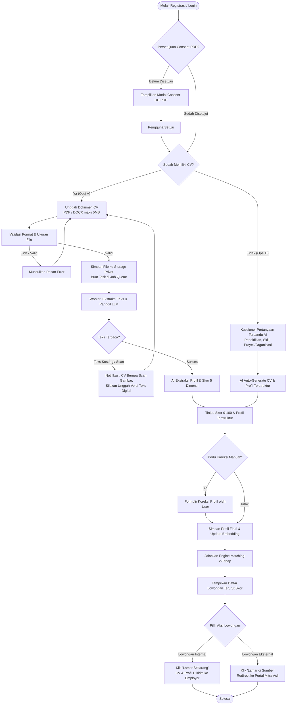
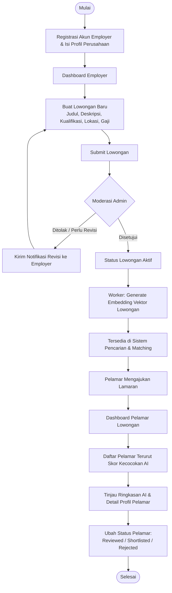
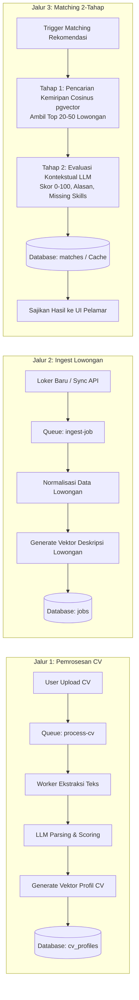
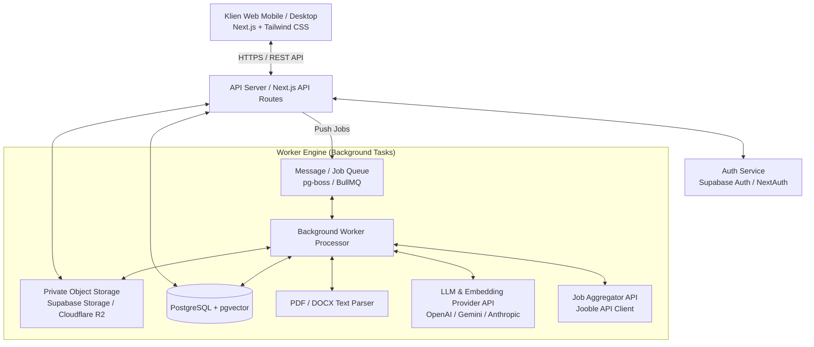
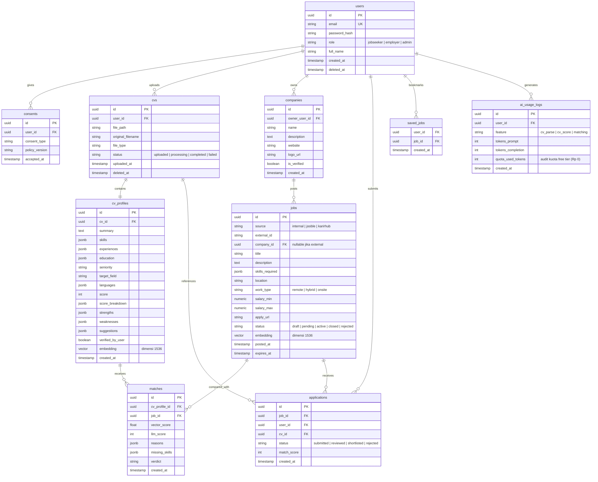

# CareerMatch AI — Workflow, Arsitektur & Model Data

Dokumen ini mendefinisikan seluruh alur operasional pengguna, rancangan pipeline kecerdasan buatan (AI asinkron), diagram arsitektur teknis, dan rancangan model data database sistem.

---

## 1. Alur Pengguna (User Journeys)

### 1.1 Alur Pencari Kerja (Job Seeker Flow)

Pencari kerja diberikan **2 pilihan metode input profil**:
1. **Opsi A (Sudah Memiliki CV):** Mengunggah berkas CV format PDF atau DOCX (maks 5 MB). AI worker akan mengekstrak teks, menilai kualitas, dan menyusun profil terstruktur.
2. **Opsi B (Belum Memiliki CV):** Sistem menyediakan **kuesioner pertanyaan terpandu (*Guided Wizard Form*)** seputar riwayat pendidikan, keahlian utama, pengalaman organisasi/magang/proyek, dan minat karir. AI akan **secara otomatis membuatkan resume/CV terstruktur** berdasarkan jawaban yang diisi.

Kedua opsi bermuara pada profil terstruktur dan skor evaluasi yang dapat ditinjau serta dikoreksi oleh pengguna sebelum dicocokkan dengan lowongan kerja.

> 🎨 **Diagram Desain Interaktif:** [Buka Versi HTML Interaktif](diagrams/alur-pencari-kerja.html) · [Buka Berkas Vektor SVG](diagrams/alur-pencari-kerja.svg)



<details>
<summary>Lihat Notasi Kode Alur (Mermaid Flowchart)</summary>



</details>

---

### 1.2 Alur Pemberi Kerja (Employer Flow)

Employer mendaftarkan profil perusahaan, mempublikasikan lowongan pekerjaan baru, dan meninjau pelamar yang telah diperingkat oleh AI.

> 🎨 **Diagram Desain Interaktif:** [Buka Versi HTML Interaktif](diagrams/alur-employer.html) · [Buka Berkas Vektor SVG](diagrams/alur-employer.svg)



<details>
<summary>Lihat Notasi Kode Alur (Mermaid Flowchart)</summary>



</details>

---

## 2. Pipeline AI Asinkron (AI Async Processing)

Untuk menjamin performa responsif tanpa memblokir koneksi HTTP pengguna, seluruh komputasi intensif (ekstraksi teks, request LLM, dan kalkulasi vektor) didelegasikan ke antrean latar belakang (*background job queue*).

> 🎨 **Diagram Desain Interaktif:** [Buka Versi HTML Interaktif](diagrams/pipeline-ai.html) · [Buka Berkas Vektor SVG](diagrams/pipeline-ai.svg)



<details>
<summary>Lihat Notasi Kode Pipeline (Mermaid Flowchart)</summary>



</details>

### Mekanisme Matching Dua Tahap (*Two-Stage Matching*)
1. **Tahap 1 (Vektor Kemiripan - Filter Cepat & Murah):**
   - Menggunakan model *text embedding* (misal: `text-embedding-3-small` atau sekelasnya) berdimensi 1536.
   - Kueri SQL pgvector memanfaatkan indeks HNSW / IVFFlat untuk menyaring puluhan ribu lowongan menjadi 20–50 kandidat teratas dalam waktu $< 100\text{ ms}$.
2. **Tahap 2 (LLM Re-Ranking & Gap Analysis - Akurat & Kontekstual):**
   - Mengirimkan profil terstruktur pelamar bersama 20 kandidat lowongan teratas ke LLM dengan prompt terstandar.
   - LLM memvalidasi pemenuhan syarat spesifik, menentukan kesenjangan keahlian (*missing skills*), serta memberikan skor akhir dan justifikasi objektif.

---

## 3. Arsitektur Sistem & Tech Stack

Platform mengusung arsitektur monolit modular (atau modular micro-service) yang efisien untuk skala MVP hingga ribuan pengguna aktif:

> 🎨 **Diagram Desain Interaktif:** [Buka Versi HTML Interaktif](diagrams/arsitektur-sistem.html) · [Buka Berkas Vektor SVG](diagrams/arsitektur-sistem.svg)



<details>
<summary>Lihat Notasi Kode Arsitektur (Mermaid Flowchart)</summary>



</details>

### Detail Pilihan Teknologi (Final Stack Sesuai Peran Tim)
- **Frontend (`frontend/` - Wira Fikri Ramadanu):**
  - Next.js (App Router, TypeScript) + Tailwind CSS + Lucide React + TanStack Query.
  - Mobile-first responsive UI, visualisasi skor radial, formulir koreksi interaktif.
- **Backend API (`backend-api/` - Muhammad Gilang Ramadhan):**
  - Node.js + Express (TypeScript), Prisma ORM / pg node driver.
  - PostgreSQL $\ge 15$ dengan ekstensi `pgvector`.
  - Autentikasi JWT / Sessions, RBAC role middleware, Pre-signed Storage URL handler.
- **Backend AI (`backend-ai/` - Florensius Panca Gati):**
  - Python 3.11+ dengan **FastAPI**, Pydantic v2, Uvicorn.
  - Ekstraksi Dokumen: `pypdf`, `python-docx` / `pdfplumber`.
  - AI Orchestration: LangChain / LiteLLM / Gemini SDK / OpenAI SDK.
  - Vector & Embedding: Embedding 1536-dimensi, hybrid cosine matching engine.
  - Integrasi API Eksternal: Jooble API Ingestion Client.

---

## 4. Model Data & Skema Database

Sistem tersusun atas 10 tabel relasional utama:

> 🎨 **Diagram Desain Interaktif:** [Buka Versi HTML Interaktif](diagrams/model-data-erd.html) · [Buka Berkas Vektor SVG](diagrams/model-data-erd.svg)



<details>
<summary>Lihat Notasi Kode ERD (Mermaid ER Diagram)</summary>



</details>

---

## 5. Kontrak Data Output AI (JSON Schemas)

### 5.1 Skema Keluaran Profil CV (`cv_profiles`)
```json
{
  "$schema": "http://json-schema.org/draft-07/schema#",
  "title": "CVAnalysisOutput",
  "type": "object",
  "required": [
    "summary",
    "skills",
    "experiences",
    "education",
    "seniority",
    "score",
    "score_breakdown",
    "strengths",
    "weaknesses",
    "suggestions"
  ],
  "properties": {
    "summary": { "type": "string", "description": "Ringkasan profesional 2-3 kalimat" },
    "skills": {
      "type": "array",
      "items": { "type": "string" },
      "description": "Daftar keahlian teknis dan non-teknis"
    },
    "experiences": {
      "type": "array",
      "items": {
        "type": "object",
        "properties": {
          "title": { "type": "string" },
          "company": { "type": "string" },
          "start": { "type": "string", "example": "2023-01" },
          "end": { "type": ["string", "null"], "example": "2024-06" },
          "highlights": { "type": "array", "items": { "type": "string" } }
        }
      }
    },
    "education": {
      "type": "array",
      "items": {
        "type": "object",
        "properties": {
          "degree": { "type": "string" },
          "institution": { "type": "string" },
          "year": { "type": "integer" }
        }
      }
    },
    "seniority": {
      "type": "string",
      "enum": ["intern", "junior", "mid", "senior", "lead"]
    },
    "field": { "type": "string", "description": "Bidang industri dominan" },
    "languages": { "type": "array", "items": { "type": "string" } },
    "score": { "type": "integer", "minimum": 0, "maximum": 100 },
    "score_breakdown": {
      "type": "object",
      "required": ["struktur", "kejelasan", "pencapaian_terukur", "relevansi_skill", "kelengkapan"],
      "properties": {
        "struktur": { "type": "integer", "minimum": 0, "maximum": 20 },
        "kejelasan": { "type": "integer", "minimum": 0, "maximum": 20 },
        "pencapaian_terukur": { "type": "integer", "minimum": 0, "maximum": 20 },
        "relevansi_skill": { "type": "integer", "minimum": 0, "maximum": 20 },
        "kelengkapan": { "type": "integer", "minimum": 0, "maximum": 20 }
      }
    },
    "strengths": { "type": "array", "items": { "type": "string" } },
    "weaknesses": { "type": "array", "items": { "type": "string" } },
    "suggestions": { "type": "array", "items": { "type": "string" } }
  }
}
```

### 5.2 Skema Keluaran Evaluasi Matching Lowongan (`matches`)
```json
{
  "$schema": "http://json-schema.org/draft-07/schema#",
  "title": "JobMatchEvaluationOutput",
  "type": "object",
  "required": ["job_id", "match_score", "reasons", "missing_skills", "verdict"],
  "properties": {
    "job_id": { "type": "string" },
    "match_score": { "type": "integer", "minimum": 0, "maximum": 100 },
    "reasons": {
      "type": "array",
      "items": { "type": "string" },
      "description": "2-4 poin konkret mengapa profil ini cocok dengan lowongan"
    },
    "missing_skills": {
      "type": "array",
      "items": { "type": "string" },
      "description": "Kualifikasi yang disyaratkan loker tetapi belum ada pada CV"
    },
    "verdict": {
      "type": "string",
      "enum": ["sangat_cocok", "cocok", "cukup", "kurang_cocok"]
    }
  }
}
```

